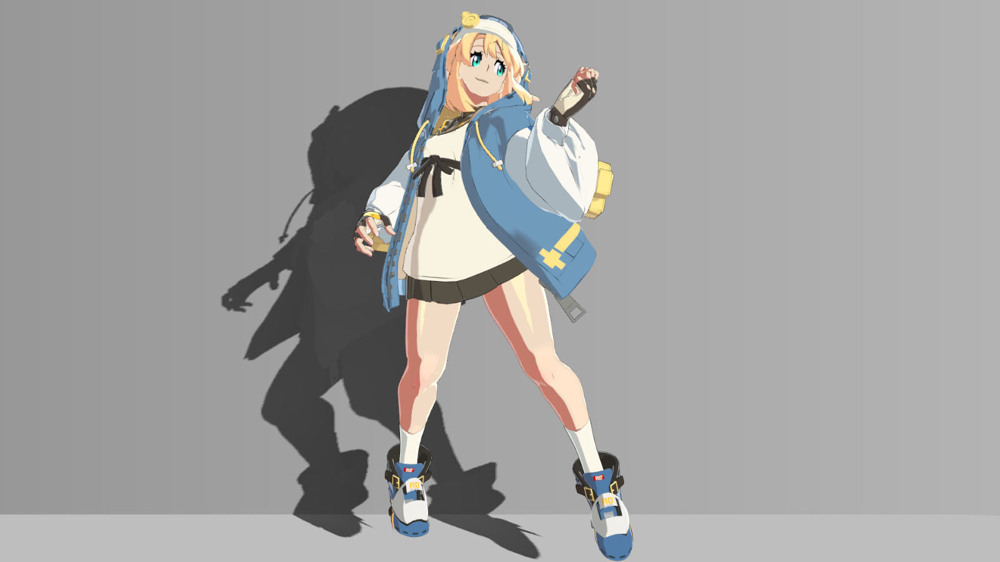

# Unity 罪恶装备风格角色渲染实操教程

从两段式明暗到材质高光与线条，学习每一步该连接什么、修改哪里、怎样调参数，以及如何从画面判断问题。

**[在线阅读](https://xuu-xuu-xuu.github.io/Guilty-Gear_Rendering_imitate/) · [在GitHub阅读正文](docs/index.md)**

适用配置：Unity **2022.3.62f3c1、Built-in渲染管线、Linear色彩空间**。读者应已有模型、贴图和正常播放的站立动画。内容只处理渲染：输入与材质连接、投影、分区明暗、配色、材质与大腿高光、眼睛、边缘光、线条和站立画面排错。

源码不包含完整工程和角色资源。接入自己的模型前，先准备[贴图/UV/顶点输入](docs/reference/channels.md)和[Renderer/Transform/Light/Camera接口](docs/reference/dependencies.md)。眼睛、胸前衣料和大腿使用图集专用坐标，换UV要重新标定；普通网格切线不能直接当作平滑描边法线。

先按[开始调参](docs/reference/practice.md)复制并分配练习材质、准备Debug入口，再从[准备环境](docs/chapters/01.md)按首页路线实现。每章说明操作位置、临时试值、预期与恢复方法。需要查值时查看[材质参数](docs/reference/parameters.md)，画面不符合预期时先用[Debug分量](docs/reference/debug.md)隔离问题，再按[站立排错步骤](docs/chapters/14.md)定位。

未附独立同条件截图的参数试验依据源码说明预期，尚未在Unity逐项验证；新增Debug窗口也尚未在Unity编译或运行验证。缺少原有呈现类型或专用UV时，先按依赖和输入页限定可练范围，不能将Shader快照当作完整工程。

源码、角色截图和第三方依赖各有使用边界，见[来源说明](THIRD_PARTY_NOTICES.md)。
