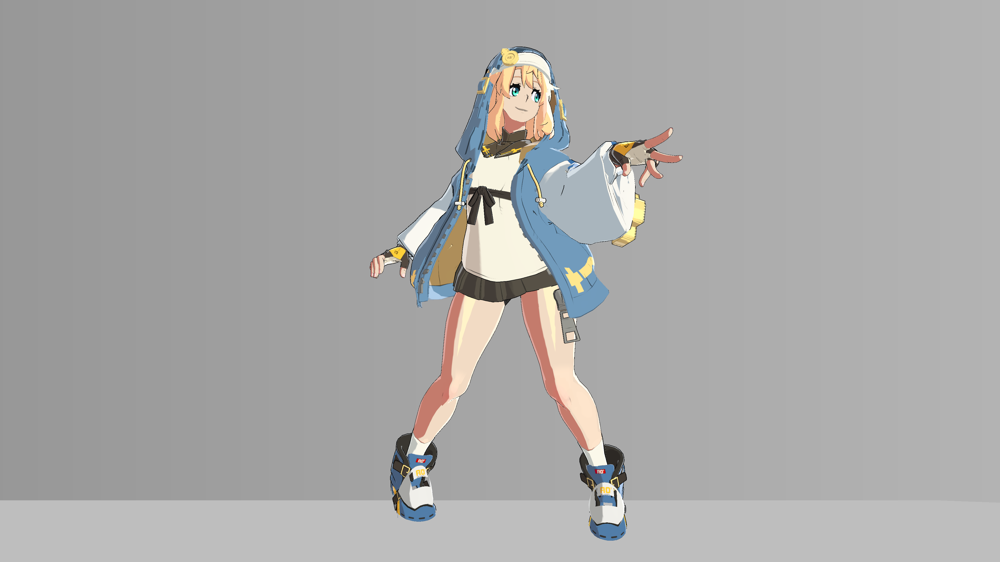

# 00 最终效果、复刻目标与适用范围

> 主体依据不可变源码与保存数据；原配图为2026-10-20历史产物。2026-10-21新增的隔离Unity静态实验单独标注，仅其所列条件已实测，其他独立练习/Play验证仍待补。

## 视觉问题与原理

画面首先要读得出角色，再读得出材质。当前实现将连续受光压成清楚的明暗块，以独立遮罩控制皮肤、衣料、头发和金属，最后用内部墨线与屏幕像素描边组织轮廓。它是针对当前模型、图集和参考光照制作的美术近似，不宣称恢复原游戏内部算法。

“复刻”在这里指理解当前项目如何产生这种画面：两段式明暗解决体积概括，分区与 Palette 解决脸和衣料的可读性，材质高光及大腿局部亮块补充质感，眼睛、rim 与线条完成层次。读者已有能正常站立循环的模型和动画；教程不涉及解包、骨骼修复、动画移植、Bind Pose 或控制器重建。

先认识三个证据层：源码说明计算；磁盘保存值说明起点；历史截图说明曾经得到的画面。三者结合仍不等于今天在新环境重新运行过。

## 真实效果与比较边界

| 左图 | 右图 |
|---|---|
| [](../assets/images/project/final.png) | [](../assets/images/stages/08.png) |

- **project/final.png**：原工程历史验收图；非 Debug。只作本图效果/诊断展示，未有清单授权的单变量配对；不可与演示副本作单变量比较。原产物 `thigh_highlight_20261020/verified_play_2.png`。原始说明：historical final project playback screenshot; actual project has projection。
- **stages/08.png**：独立演示副本历史原生4K图；非 Debug；固定镜头与站立 cell 00 的累计展示，省略投影、构图和4K线宽与主工程不同。相邻阶段是效果组累计对照，不是所有参数独立实验。原产物 `render_demo_4k_20261020/frames/stage_08/cell_00.png`。原始说明：边缘光; cumulative stage, fixed camera and same standing cell 00; projection intentionally omitted。

完整尺寸、哈希和来源映射见[图片附录](../reference/images.md)。本章证据范围：readonly_audit; project_snapshot_comparison；范围说明，非新运行。

## 源码位置与原文摘录

- [BridgetToon.shader:189–203](../reference/code/BridgetToon.shader.md#l189)：FORWARD / ForwardBase：vert、frag。

下列均为原文件连续摘录，保留原始代码；只展示局部上下文，**不是独立可编译实现**。完整分支见逐行索引。

用途：核对本章所述计算/写入；来源 [BridgetToon.shader:189–203](../reference/code/BridgetToon.shader.md#l189)。

```hlsl
    SubShader
    {
        Tags {"RenderType"="Opaque" "Queue"="Geometry"}
        LOD 200
        Pass
        {
            Name "FORWARD"
            Tags {"LightMode"="ForwardBase"}
            Cull [_CullMode] ZWrite On
            Offset [_DepthOffsetFactor], [_DepthOffsetUnits]
            CGPROGRAM
            #pragma target 3.0
            #pragma vertex vert
            #pragma fragment frag
            #pragma multi_compile_fwdbase nolightmap nodirlightmap nodynlightmap novertexlight
```

## 输入合同与脚本依赖

已有角色 Renderer、正常播放的站立动画、自有纹理及 UV 是练习前提。本包只含渲染源码快照、接口数值、截图与历史报告，没有模型、贴图像素（包括自制遮罩）或 Unity 场景。

主体为 Built-in 的 Opaque Shader，颜色输出 Alpha=1；同一视觉结果由材质参数、Renderer 的 MaterialPropertyBlock（MPB，逐渲染器属性覆盖）和全局阴影纹理共同决定。各类型不可互换：Vector 是计算乘数或坐标，Color 是颜色参数，屏幕取色还受到采样、光照和显示转换影响。

## 当前参数：默认值与保存值

以下从 material_parameters.csv 自动提取，B=Base、S=BaseSecondary、F=BodyBaseFlip、C=CoatExterior；“未保存”表示字段不存在。类型及默认来自声明记录，保存值来自磁盘，**不是运行中逐帧采样**。MPB/Global 和内部覆盖见[覆盖附录](../reference/overrides.md)，完整账本见[参数附录](../reference/parameters.md)。

| 属性 | 类型 | 默认 | B 保存 | S 保存 | F 保存 | C 保存 |
|---|---|---|---|---|---|---|
| _ThighLobeEnabled | Range(0,1) | 0.0 | 1 | 1 | 1 | 1 |
| _FocusedShadeEnabled | Range(0,1) | 0.0 | 1 | 1 | 1 | 1 |
| _FocusedSpecEnabled | Range(0,1) | 0.0 | 1 | 1 | 1 | 1 |
| _CleanShadeEnabled | Range(0,1) | 0.0 | 1 | 1 | 1 | 1 |
| _PaletteEnabled | Range(0,1) | 0.0 | 1 | 1 | 1 | 1 |
| _ReferenceRimEnabled | Range(0,1) | 0.0 | 1 | 1 | 1 | 1 |
| _FourMaterialSpecEnabled | Range(0,1) | 0.0 | 1 | 1 | 1 | 1 |

## 独立练习的操作步骤

1. 从独立练习工程开始，保留自己的已有动画；记录相机、主光、分辨率和资源版本，不修改原资料包。
2. 先读 01–04，建立环境、纹理、材质和执行顺序；不要直接复制三个 C# 脚本并期待零依赖编译。
3. 依次练习 05–13，每次只改变一个可解释的效果开关，保存自己的对照图。
4. 按 14 章进行静态分层及站立循环检查；将未完成项保留为待补，而不是用历史通过替代。

## 如何验收与排错

先将原工程历史最终画面与无投影的 4K 副本当作两种展示条件阅读。两图构图、投影和线宽不同，不能据差异计算某个参数的效果。后续独立练习需要自己建立同镜头、同姿势、同资源的比较集。

常见错误是以“模型看起来像”替代参数和输入核对，或以网站构建通过宣称渲染复刻通过。2026-10-21已补充完整工程隔离副本的静态Unity渲染实验；全新空工程的编译、资源连接及渲染验收仍待补。

## 依赖及相互影响

学习顺序是问题驱动；真实执行顺序见 04。所有章节均受 02 的数据契约和 03 的运行覆盖约束。主要开关在四主体材质均保存为 1，但 Shader 默认大多为 0，不能把“新建同名材质”视为现有最终配置。

[返回章节导航](../index.md) · [章节—证据表](../reference/evidence-map.md) · [依赖接口](../reference/dependencies.md)
