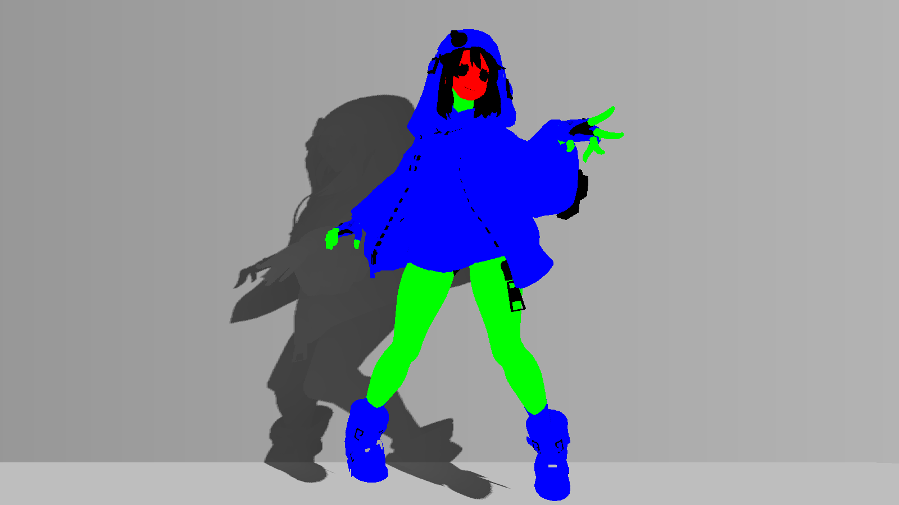

# 整理脸部、皮肤和衣料明暗

脸部暗带、腹部碎影和白袖发灰，不能只用一个全局阈值解决。先分区，再为脸、身体皮肤和衣料使用不同的明暗规则。

| 对照 | 对照 |
|---|---|
| **脸部效果近景** [](../assets/images/project/face.png) | **Debug38：覆盖范围** [](../assets/images/project/region_debug.png) |

两图用途和取景不同，用来分别认识效果与覆盖，不作为效果开关A/B。

## 准备输入

RegionalMask.R/G分别为皮肤/白袖；_RegionalHead把皮肤分成脸和身体。FourMaterialSpecMask.G提供其他布料区域，ILM.G、顶点R和世界法线继续参与受光。

胸前衣料使用2048图集的两块域：x768.5…895.5/y640.5…895.5和x512.5…895.5/y895.5…1343.5；y=(1-v)×2048。腿域为x200…510/y880…1195。使用不同UV时，先重定这些域或制作相应遮罩，不要先调阈值。

## 在哪里操作

头部下暗面参数改头材质，身体皮肤/白袖/腿参数改它们实际使用的材质。示例中共享材质的多个Renderer会同时受影响，先分配自己的练习副本。头体标志仍在MPB输入层。

## 操作步骤

1. 确认Regional的Strength=1且头体标志正确，在目标练习材质将`_CleanShadeEnabled=1`。先用22看脸/身体皮肤/白袖，再用38看CleanShade覆盖。预期遮罩只覆盖目标区域；域外变化先查分类和区域，不调整阴色来遮掩串区。
2. 先把`_FocusedShadeEnabled=0`作为隔离设置，在Debug16观察；Palette等保持记录值不动。这样检查基础身体皮肤阈值时，不会被腿域的Focused阈值替换。结束此小段后要恢复Focused=1。
3. 在头材质把`_CleanFaceUnderStart=-0.7`、`_CleanFaceUnderEnd=-0.45`作为起点。只将End暂改-0.3，再恢复-0.45；按世界n.y的smoothstep，部分原过渡区更难全亮，应改变下暗面过渡。若改旧的_FaceDiffuseBoundary而这里不变，属于后续重建，不是参数失效。
4. 在身体材质只将`_SkinShadeThreshold`从0.69暂改0.74，观察身体皮肤亮区缩小后恢复；再把`_SleeveShadeThreshold`从0.68暂改0.73，观察白袖后恢复。以上是练习试值，未附单参数截图；没有信号跨过阈值时不保证肉眼可见。一次只做一组，域外不应受此阈值直接影响。
5. 在含其他衣料的材质确认`_CleanClothMaskWeight=0.4`、`_CleanClothAOWeight=0.25`、`_CleanClothSoftness=0.018`。先把MaskWeight暂设0并恢复，再把AOWeight暂设0并恢复：分别减少ILM.G与顶点R对衣料信号的影响。它们不负责脸下暗面，不能用这组数调整脸。
6. 恢复`_FocusedShadeEnabled=1`，用41看腿的局部band、42看胸前衣料band。示例腿阈值大腿/小腿/膝=0.57/0.59/0.62，衣料=0.4。只把大腿阈值暂改0.62，41应仅在匹配腿UV域改变，42不应因这一个参数变化；随后恢复0.57，回16再回0。换UV未重标定时不要据此判断解剖区域已被识别。

## 原理与代码位置

脸、身体皮肤、白袖分别来自region.r×head、region.r×(1-head)、region.g×(1-head)。CleanShade在覆盖区重建diffuse，并纳入Palette乘数。

脸的简化下暗面主要是`smoothstep(_CleanFaceUnderStart,_CleanFaceUnderEnd,n.y)`，不是通用脸SDF，也不保证头大幅旋转时仍符合美术预期。其他布料使用独立分类并排除已经覆盖的区域，避免重复计入。

FocusedShade以差值修改已有的CleanShade局部结果。腿的阈值依图集位置在大腿0.57、小腿0.59和膝0.62之间变化，胸前衣料为0.4；不是自动识别解剖结构。

- [BridgetToon.shader:405–458](../reference/code/BridgetToon.shader.md#l405)：FORWARD：vert / frag及其计算函数。
- [BridgetToon.shader:479–518](../reference/code/BridgetToon.shader.md#l479)：FORWARD：vert / frag及其计算函数。

局部摘录（需结合完整上下文）：[BridgetToon.shader:405–410](../reference/code/BridgetToon.shader.md#l405)。

```hlsl
                float2 region=saturate(tex2D(_RegionalMask,i.uv.xy).rg)*saturate(_RegionalEnabled);
                float head=saturate(_RegionalHead);
                float faceRegionMask=region.r*head;
                float bodySkinRegion=region.r*(1.0-head);
                float sleeveRegion=region.g*(1.0-head);
                float regionTotal=saturate(faceRegionMask+bodySkinRegion+sleeveRegion);
```

局部摘录（需结合完整上下文）：[BridgetToon.shader:483–501](../reference/code/BridgetToon.shader.md#l483)。

```hlsl
                float cleanFaceBand=smoothstep(_CleanFaceUnderStart,_CleanFaceUnderEnd,n.y);
                float cleanSkinBand=skinBand;
                float cleanClothSignal=(nl+_RampOffset+(ilm.g-_RampMaskCenter)*_RampMaskStrength*_CleanClothMaskWeight)*lerp(1.0,ao,_CleanClothAOWeight);
                float cleanClothBand=smoothstep(_LightTreshold-_CleanClothSoftness,_LightTreshold+_CleanClothSoftness,cleanClothSignal);
                float cleanSleeveBand=smoothstep(_SleeveShadeThreshold-_CleanClothSoftness,_SleeveShadeThreshold+_CleanClothSoftness,cleanClothSignal);
                float cleanTunicBand=cleanClothBand;
                float cleanClothClass=saturate(tex2D(_FourMaterialSpecMask,i.uv.xy).g)*saturate(_FourMaterialSpecEnabled)*(1.0-head);
                float cleanOtherCloth=cleanClothClass*(1.0-saturate(paletteSkin+sleeveRegion+tunicRegion));
                float cleanTotal=paletteSkin+sleeveRegion+tunicRegion+cleanOtherCloth;
                float cleanCoverage=saturate(cleanTotal);
                float3 cleanGate=float3(faceRegionMask,bodySkinRegion,saturate(sleeveRegion+tunicRegion+cleanOtherCloth));
                half3 cleanClothDark=lerp(albedo,sss*_ShadowTint.rgb,_ShadowIntensity);
                half3 cleanFace=lerp(faceDiffuseDark,albedo,cleanFaceBand)*lerp(float3(1,1,1),lerp(_PaletteSkinDark.rgb,_PaletteSkinLight.rgb,cleanFaceBand),saturate(_PaletteEnabled));
                half3 cleanSkin=lerp(skinDark,albedo,cleanSkinBand)*lerp(float3(1,1,1),lerp(_PaletteSkinDark.rgb,_PaletteSkinLight.rgb,cleanSkinBand),saturate(_PaletteEnabled));
                half3 cleanSleeve=lerp(sleeveDark,albedo,cleanSleeveBand)*lerp(float3(1,1,1),lerp(_PaletteSleeveDark.rgb,_PaletteSleeveLight.rgb,cleanSleeveBand),saturate(_PaletteEnabled));
                half3 cleanTunic=lerp(cleanClothDark,albedo,cleanTunicBand)*lerp(float3(1,1,1),lerp(_PaletteTunicDark.rgb,_PaletteTunicLight.rgb,cleanTunicBand),saturate(_PaletteEnabled));
                half3 cleanCloth=lerp(cleanClothDark,albedo,cleanClothBand);
                half3 cleanDiffuse=(cleanFace*faceRegionMask+cleanSkin*bodySkinRegion+cleanSleeve*sleeveRegion+cleanTunic*tunicRegion+cleanCloth*cleanOtherCloth)/max(cleanTotal,0.0001)*_LightColor0.rgb*_LightIntensity;
                diffuse=lerp(diffuse,cleanDiffuse,saturate(_CleanShadeEnabled)*cleanCoverage);
```

局部摘录（需结合完整上下文）：[BridgetToon.shader:507–518](../reference/code/BridgetToon.shader.md#l507)。

```hlsl
                float focusedLegDomain=step(200.0,palettePixel.x)*step(palettePixel.x,510.0)*step(880.0,palettePixel.y)*step(palettePixel.y,1195.0);
                float focusedLegRegion=bodySkinRegion*focusedLegDomain;
                float focusedCalf=smoothstep(1035.0,1070.0,palettePixel.y);
                float focusedKnee=smoothstep(1015.0,1035.0,palettePixel.y)*(1.0-smoothstep(1055.0,1075.0,palettePixel.y));
                float focusedLegThreshold=lerp(_FocusedThighThreshold,_FocusedCalfThreshold,focusedCalf);
                focusedLegThreshold=lerp(focusedLegThreshold,_FocusedKneeThreshold,focusedKnee);
                float focusedLegBand=smoothstep(focusedLegThreshold-regionSoft,focusedLegThreshold+regionSoft,regionalSignal);
                float focusedSkinBand=lerp(cleanSkinBand,focusedLegBand,focusedLegDomain*saturate(_FocusedShadeEnabled));
                float focusedTunicBand=lerp(cleanTunicBand,smoothstep(_FocusedTunicThreshold-_CleanClothSoftness,_FocusedTunicThreshold+_CleanClothSoftness,cleanClothSignal),saturate(_FocusedShadeEnabled));
                half3 focusedSkin=lerp(skinDark,albedo,focusedSkinBand)*lerp(float3(1,1,1),lerp(_PaletteSkinDark.rgb,_PaletteSkinLight.rgb,focusedSkinBand),saturate(_PaletteEnabled));
                half3 focusedTunic=lerp(cleanClothDark,albedo,focusedTunicBand)*lerp(float3(1,1,1),lerp(_PaletteTunicDark.rgb,_PaletteTunicLight.rgb,focusedTunicBand),saturate(_PaletteEnabled));
                diffuse+=((focusedSkin-cleanSkin)*focusedLegRegion+(focusedTunic-cleanTunic)*tunicRegion)/max(cleanTotal,0.0001)*_LightColor0.rgb*_LightIntensity*saturate(_CleanShadeEnabled)*cleanCoverage;
```

## 参数怎么调

下表区分Shader默认值与四主体材质设置。Base/Secondary/Flip/Coat对应四种主体材质；同名字段还可能被[MPB或全局输入](../reference/overrides.md)覆盖。完整属性类型和纹理绑定见[参数参考](../reference/parameters.md)。

| 属性 | Inspector名称 | 类型 | Shader默认 | 材质设置 | 作用 |
|---|---|---|---|---|---|
| _CleanShadeEnabled | 角色简洁漫反射明暗 | Range(0,1) | 0.0 | 1 | 启用区域漫反射重建 |
| _CleanFaceUnderStart | 下颌暗面起点 | Range(-1,0) | -0.7 | -0.7 | 脸下暗面过渡起点，使用世界n.y |
| _CleanFaceUnderEnd | 下颌亮面起点 | Range(-1,0.2) | -0.45 | -0.45 | 脸下暗面过渡终点 |
| _CleanClothMaskWeight | 衣料明暗遮罩参与 | Range(0,1) | 0.4 | 0.4 | 衣料对ILM.G的依赖 |
| _CleanClothAOWeight | 衣料顶点暗部参与 | Range(0,1) | 0.25 | 0.25 | 衣料对顶点AO的依赖 |
| _CleanClothSoftness | 衣料色块边界宽度 | Range(0.005,0.06) | 0.018 | 0.018 | 衣料分界过渡 |
| _SkinShadeThreshold | 身体皮肤明暗阈值 | Range(0,1) | 0.69 | 0.69 | 身体皮肤基础阈值；腿域还会被Focused修正 |
| _SleeveShadeThreshold | 白袖明暗阈值 | Range(0,1) | 0.68 | 0.68 | CleanShade白袖使用的阈值 |
| _RegionalSoftness | 分区边界宽度 | Range(0.001,0.08) | 0.018 | 0.018 | 皮肤和Focused腿域的过渡宽度 |
| _SkinShadeTint | 皮肤暗面乘色 | Color | [0.78, 0.49, 0.47, 1.0] | (0.78, 0.49, 0.47, 1) | 身体皮肤阴色乘数 |
| _SkinShadeStrength | 皮肤暖暗色强度 | Range(0,1) | 0.72 | 0.72 | 身体皮肤阴色混合 |
| _SleeveShadeTint | 白袖暗面乘色 | Color | [0.53, 0.62, 0.7, 1.0] | (0.53, 0.62, 0.7, 1) | 白袖阴色乘数 |
| _SleeveShadeStrength | 白袖冷暗色强度 | Range(0,1) | 0.72 | 0.72 | 白袖阴色混合 |
| _FaceDiffuseTint | 脸部漫反射暖暗乘色 | Color | [1.0, 0.84, 0.84, 1.0] | Base=(1, 0.84, 0.84, 1)；Secondary=(1, 0.84, 0.84, 1)；Flip=(1, 0.8399999, 0.8399999, 1)；Coat=(1, 0.8399999, 0.8399999, 1) | CleanShade脸部阴色起点的颜色 |
| _FaceDiffuseDepth | 脸部原Sss暗色混合 | Range(0,1) | 0.9 | 0.9 | CleanShade脸部阴色起点的混合强度 |
| _FocusedShadeEnabled | 腹部与腿部阴面收窄 | Range(0,1) | 0.0 | 1 | 启用腿与胸前的局部修正 |
| _FocusedTunicThreshold | 腹部明暗阈值 | Range(0.2,0.7) | 0.4 | 0.4 | 胸前衣料阈值 |
| _FocusedThighThreshold | 大腿明暗阈值 | Range(0.3,0.8) | 0.57 | 0.57 | 大腿阈值 |
| _FocusedCalfThreshold | 小腿明暗阈值 | Range(0.3,0.8) | 0.59 | 0.59 | 小腿阈值 |
| _FocusedKneeThreshold | 膝部明暗阈值 | Range(0.3,0.8) | 0.62 | 0.62 | 膝盖阈值 |

## 画面判断与排错

38是覆盖，不是亮暗；41/42才显示相应局部band。预期脸保留简洁下暗面，腹部和袖子减少小碎影，区域边界不串到头发或其他衣料。

切CleanShade后脸的投发暗带消失，可能是diffuse被重建的结果；应结合投影节定位最终路径。若世界n.y导致特殊头姿态不合适，需要为自己的角色重新设计脸部规则，不能只抄固定阈值。

[上一步：建立两段式明暗](05.md) · [下一步：调整亮面与阴面配色](07.md) · [教程导航](../index.md)
