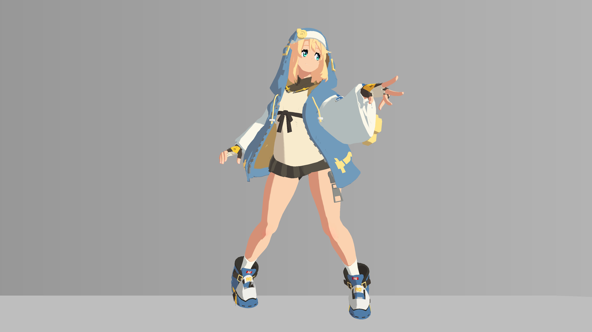
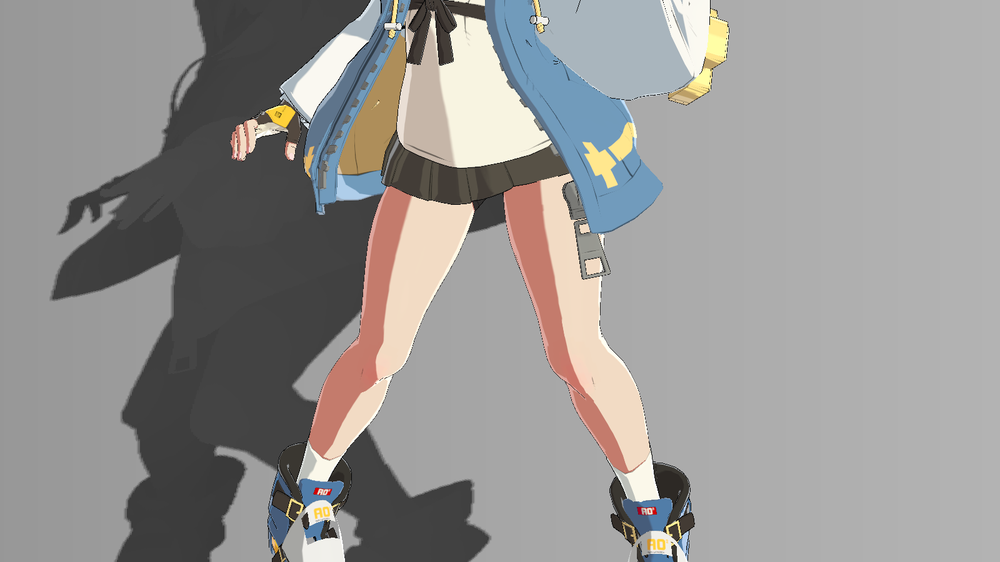

# 06 脸部、皮肤与衣料的分区明暗

> 本章依据磁盘源码与保存数据解释当前实现。所有配图均为 2026-10-20 历史产物；操作与预期供独立练习，尚未在本次 Unity 运行验证。

## 视觉问题与原理

脸上多余的暗带、腹部碎影和白袖发灰，通常不能只靠一个全局阈值解决。当前实现先用独立皮肤/白袖遮罩与头体标志划分区域，再用 CleanShade 重建简洁明暗，用 Focused 调整胸前衣料及腿部阈值。

早期 region.r×head 为脸，region.r×(1-head) 为身体皮肤，region.g×(1-head) 为白袖。旧 faceBand 还有光向选择远侧脸的逻辑与 _FaceDiffuse* 差值，但最终 CleanShade 覆盖脸时主要采用 `smoothstep(_CleanFaceUnderStart,_CleanFaceUnderEnd,n.y)`。这是世界法线向下时的简化下颌暗面，并不是通用脸部 SDF 或随脸部局部轴旋转的物理阴影。

CleanClothSignal 将 ILM.G 权重降至 _CleanClothMaskWeight=0.4，AO 权重降至0.25，softness=0.018，目的是降低小碎片而保留较大面转折。身体皮肤保留 skinBand，胸前衣料由专用 UV 域进入 tunicRegion。Focused 再将腿的阈值按图集位置在大腿0.57、小腿0.59、膝0.62之间切换；胸前衣料阈值0.4。它们是图集特定区域，不能称为自动识别解剖部位。

## 真实效果与比较边界

| 左图 | 右图 |
|---|---|
| [](../assets/images/stages/01.png) | [](../assets/images/stages/02.png) |
| [](../assets/images/project/face.png) | [](../assets/images/project/region_debug.png) |
| [](../assets/images/project/shade_before.png) | [](../assets/images/project/shade_after.png) |

- **stages/01.png**：独立演示副本历史原生4K图；非 Debug；固定镜头与站立 cell 00 的累计展示，省略投影、构图和4K线宽与主工程不同。相邻阶段是效果组累计对照，不是所有参数独立实验。原产物 `render_demo_4k_20261020/frames/stage_01/cell_00.png`。原始说明：基础两段式明暗; cumulative stage, fixed camera and same standing cell 00; projection intentionally omitted。
- **stages/02.png**：独立演示副本历史原生4K图；非 Debug；固定镜头与站立 cell 00 的累计展示，省略投影、构图和4K线宽与主工程不同。相邻阶段是效果组累计对照，不是所有参数独立实验。原产物 `render_demo_4k_20261020/frames/stage_02/cell_00.png`。原始说明：分区明暗; cumulative stage, fixed camera and same standing cell 00; projection intentionally omitted。
- **project/face.png**：原工程历史验收图；非 Debug。只作本图效果/诊断展示，未有清单授权的单变量配对；不可与演示副本作单变量比较。原产物 `thigh_highlight_20261020/controlled_face_0_on.png`。原始说明：historical final face close-up。
- **project/region_debug.png**：原工程历史验收图；Debug 输出，编号见原始图注。只作本图效果/诊断展示，未有清单授权的单变量配对；不可与演示副本作单变量比较。原产物 `thigh_highlight_20261020/controlled_full_38_on.png`。原始说明：Debug 38 clean shading coverage。
- **project/shade_before.png**：原工程历史验收图；非 Debug。历史阴影与高光同时修改的综合对照，不是纯阴影单变量实验。原产物 `shade_highlight_20261020/controlled_body_0_off.png`。原始说明：historical combined shading/specular refinement OFF; not single-variable diffuse comparison。
- **project/shade_after.png**：原工程历史验收图；非 Debug。历史阴影与高光同时修改的综合对照，不是纯阴影单变量实验。原产物 `shade_highlight_20261020/controlled_body_0_on.png`。原始说明：historical combined shading/specular refinement ON; not single-variable diffuse comparison。

完整尺寸、哈希和来源映射见[图片附录](../reference/images.md)。本章证据范围：Debug38覆盖；shade历史同时改高光，非纯阴影A/B。

## 源码位置与原文摘录

- [BridgetToon.shader:405–458](../reference/code/BridgetToon.shader.md#l405)：FORWARD / ForwardBase：vert、frag。
- [BridgetToon.shader:479–518](../reference/code/BridgetToon.shader.md#l479)：FORWARD / ForwardBase：vert、frag。

下列均为原文件连续摘录，保留原始代码；只展示局部上下文，**不是独立可编译实现**。完整分支见逐行索引。

用途：核对本章所述计算/写入；来源 [BridgetToon.shader:405–410](../reference/code/BridgetToon.shader.md#l405)。

```hlsl
                float2 region=saturate(tex2D(_RegionalMask,i.uv.xy).rg)*saturate(_RegionalEnabled);
                float head=saturate(_RegionalHead);
                float faceRegionMask=region.r*head;
                float bodySkinRegion=region.r*(1.0-head);
                float sleeveRegion=region.g*(1.0-head);
                float regionTotal=saturate(faceRegionMask+bodySkinRegion+sleeveRegion);
```

用途：核对本章所述计算/写入；来源 [BridgetToon.shader:483–501](../reference/code/BridgetToon.shader.md#l483)。

```hlsl
                float cleanFaceBand=smoothstep(_CleanFaceUnderStart,_CleanFaceUnderEnd,n.y);
                float cleanSkinBand=skinBand;
                float cleanClothSignal=(nl+_RampOffset+(ilm.g-_RampMaskCenter)*_RampMaskStrength*_CleanClothMaskWeight)*lerp(1.0,ao,_CleanClothAOWeight);
                float cleanClothBand=smoothstep(_LightTreshold-_CleanClothSoftness,_LightTreshold+_CleanClothSoftness,cleanClothSignal);
                float cleanSleeveBand=smoothstep(_SleeveShadeThreshold-_CleanClothSoftness,_SleeveShadeThreshold+_CleanClothSoftness,cleanClothSignal);
                float cleanTunicBand=cleanClothBand;
                float cleanClothClass=saturate(tex2D(_FourMaterialSpecMask,i.uv.xy).g)*saturate(_FourMaterialSpecEnabled)*(1.0-head);
                float cleanOtherCloth=cleanClothClass*(1.0-saturate(paletteSkin+sleeveRegion+tunicRegion));
                float cleanTotal=paletteSkin+sleeveRegion+tunicRegion+cleanOtherCloth;
                float cleanCoverage=saturate(cleanTotal);
                float3 cleanGate=float3(faceRegionMask,bodySkinRegion,saturate(sleeveRegion+tunicRegion+cleanOtherCloth));
                half3 cleanClothDark=lerp(albedo,sss*_ShadowTint.rgb,_ShadowIntensity);
                half3 cleanFace=lerp(faceDiffuseDark,albedo,cleanFaceBand)*lerp(float3(1,1,1),lerp(_PaletteSkinDark.rgb,_PaletteSkinLight.rgb,cleanFaceBand),saturate(_PaletteEnabled));
                half3 cleanSkin=lerp(skinDark,albedo,cleanSkinBand)*lerp(float3(1,1,1),lerp(_PaletteSkinDark.rgb,_PaletteSkinLight.rgb,cleanSkinBand),saturate(_PaletteEnabled));
                half3 cleanSleeve=lerp(sleeveDark,albedo,cleanSleeveBand)*lerp(float3(1,1,1),lerp(_PaletteSleeveDark.rgb,_PaletteSleeveLight.rgb,cleanSleeveBand),saturate(_PaletteEnabled));
                half3 cleanTunic=lerp(cleanClothDark,albedo,cleanTunicBand)*lerp(float3(1,1,1),lerp(_PaletteTunicDark.rgb,_PaletteTunicLight.rgb,cleanTunicBand),saturate(_PaletteEnabled));
                half3 cleanCloth=lerp(cleanClothDark,albedo,cleanClothBand);
                half3 cleanDiffuse=(cleanFace*faceRegionMask+cleanSkin*bodySkinRegion+cleanSleeve*sleeveRegion+cleanTunic*tunicRegion+cleanCloth*cleanOtherCloth)/max(cleanTotal,0.0001)*_LightColor0.rgb*_LightIntensity;
                diffuse=lerp(diffuse,cleanDiffuse,saturate(_CleanShadeEnabled)*cleanCoverage);
```

用途：核对本章所述计算/写入；来源 [BridgetToon.shader:507–518](../reference/code/BridgetToon.shader.md#l507)。

```hlsl
                float focusedLegDomain=step(200.0,palettePixel.x)*step(palettePixel.x,510.0)*step(880.0,palettePixel.y)*step(palettePixel.y,1195.0);
                float focusedLegRegion=bodySkinRegion*focusedLegDomain;
                float focusedCalf=smoothstep(1035.0,1070.0,palettePixel.y);
                float focusedKnee=smoothstep(1015.0,1035.0,palettePixel.y)*(1.0-smoothstep(1055.0,1075.0,palettePixel.y));
                float focusedLegThreshold=lerp(_FocusedThighThreshold,_FocusedCalfThreshold,focusedCalf);
                focusedLegThreshold=lerp(focusedLegThreshold,_FocusedKneeThreshold,focusedKnee);
                float focusedLegBand=smoothstep(focusedLegThreshold-regionSoft,focusedLegThreshold+regionSoft,regionalSignal);
                float focusedSkinBand=lerp(cleanSkinBand,focusedLegBand,focusedLegDomain*saturate(_FocusedShadeEnabled));
                float focusedTunicBand=lerp(cleanTunicBand,smoothstep(_FocusedTunicThreshold-_CleanClothSoftness,_FocusedTunicThreshold+_CleanClothSoftness,cleanClothSignal),saturate(_FocusedShadeEnabled));
                half3 focusedSkin=lerp(skinDark,albedo,focusedSkinBand)*lerp(float3(1,1,1),lerp(_PaletteSkinDark.rgb,_PaletteSkinLight.rgb,focusedSkinBand),saturate(_PaletteEnabled));
                half3 focusedTunic=lerp(cleanClothDark,albedo,focusedTunicBand)*lerp(float3(1,1,1),lerp(_PaletteTunicDark.rgb,_PaletteTunicLight.rgb,focusedTunicBand),saturate(_PaletteEnabled));
                diffuse+=((focusedSkin-cleanSkin)*focusedLegRegion+(focusedTunic-cleanTunic)*tunicRegion)/max(cleanTotal,0.0001)*_LightColor0.rgb*_LightIntensity*saturate(_CleanShadeEnabled)*cleanCoverage;
```

## 输入合同与脚本依赖

RegionalMask.R/G、FourMaterialSpecMask.G、ILM.G、顶点R、世界法线与 head MPB。CleanShade 里的 cleanOtherCloth 还要求 _FourMaterialSpecEnabled，并排除已覆盖的皮肤/袖/胸前衣料，防止重复计入。

胸前衣料像素域来自2048图集：上块 x=768.5…895.5/y=640.5…895.5，下块 x=512.5…895.5/y=895.5…1343.5；坐标 y=(1-v)×2048。腿域 x=200…510/y=880…1195。换模型时必须重新定位这些岛或用自己制作的区域遮罩替代教学练习逻辑，不能照抄坐标就认定通用。

## 当前参数：默认值与保存值

以下从 material_parameters.csv 自动提取，B=Base、S=BaseSecondary、F=BodyBaseFlip、C=CoatExterior；“未保存”表示字段不存在。类型及默认来自声明记录，保存值来自磁盘，**不是运行中逐帧采样**。MPB/Global 和内部覆盖见[覆盖附录](../reference/overrides.md)，完整账本见[参数附录](../reference/parameters.md)。

| 属性 | 类型 | 默认 | B 保存 | S 保存 | F 保存 | C 保存 |
|---|---|---|---|---|---|---|
| _FocusedShadeEnabled | Range(0,1) | 0.0 | 1 | 1 | 1 | 1 |
| _FocusedTunicThreshold | Range(0.2,0.7) | 0.4 | 0.4 | 0.4 | 0.4 | 0.4 |
| _FocusedThighThreshold | Range(0.3,0.8) | 0.57 | 0.57 | 0.57 | 0.57 | 0.57 |
| _FocusedCalfThreshold | Range(0.3,0.8) | 0.59 | 0.59 | 0.59 | 0.59 | 0.59 |
| _FocusedKneeThreshold | Range(0.3,0.8) | 0.62 | 0.62 | 0.62 | 0.62 | 0.62 |
| _CleanShadeEnabled | Range(0,1) | 0.0 | 1 | 1 | 1 | 1 |
| _CleanClothMaskWeight | Range(0,1) | 0.4 | 0.4 | 0.4 | 0.4 | 0.4 |
| _CleanClothAOWeight | Range(0,1) | 0.25 | 0.25 | 0.25 | 0.25 | 0.25 |
| _CleanClothSoftness | Range(0.005,0.06) | 0.018 | 0.018 | 0.018 | 0.018 | 0.018 |
| _CleanFaceUnderStart | Range(-1,0) | -0.7 | -0.7 | -0.7 | -0.7 | -0.7 |
| _CleanFaceUnderEnd | Range(-1,0.2) | -0.45 | -0.45 | -0.45 | -0.45 | -0.45 |
| _FaceDiffuseRefine | Range(0,1) | 0.0 | 1 | 1 | 0 | 0 |
| _FaceDiffuseBoundary | Range(0.25,0.85) | 0.54 | 0.54 | 0.54 | 0.54 | 0.54 |
| _FaceDiffuseEdge | Range(0.015,0.12) | 0.045 | 0.045 | 0.045 | 0.045 | 0.045 |
| _FaceDiffuseSide | Range(0,1) | 0.9 | 0.9 | 0.9 | 0.9 | 0.9 |
| _FaceDiffuseDepth | Range(0,1) | 0.9 | 0.9 | 0.9 | 0.9 | 0.9 |
| _FaceDiffuseTint | Color | [1.0, 0.84, 0.84, 1.0] | {"r": 1, "g": 0.84, "b": 0.84, "a": 1} | {"r": 1, "g": 0.84, "b": 0.84, "a": 1} | {"r": 1, "g": 0.8399999, "b": 0.8399999, "a": 1} | {"r": 1, "g": 0.8399999, "b": 0.8399999, "a": 1} |
| _RegionalEnabled | Float | 0.0 | 0 | 0 | 0 | 0 |
| _RegionalHead | Float | 0.0 | 0 | 0 | 0 | 0 |
| _FaceShadeThreshold | Range(0,1) | 0.8 | 0.8 | 0.8 | 0.8 | 0.8 |
| _SkinShadeThreshold | Range(0,1) | 0.69 | 0.69 | 0.69 | 0.69 | 0.69 |
| _SleeveShadeThreshold | Range(0,1) | 0.68 | 0.68 | 0.68 | 0.68 | 0.68 |
| _RegionalSoftness | Range(0.001,0.08) | 0.018 | 0.018 | 0.018 | 0.018 | 0.018 |

## 独立练习的操作步骤

1. 先按03把头/体 MPB 接正确，用22确认脸、身体皮肤、白袖互不串区。
2. 开 CleanShade，用38看覆盖，16看最终漫反射。保持 Palette 和材质高光不变，先判断明暗块是否连续；需要隔离时只在练习副本关闭高光并记录。
3. 以脸下颌为观察区，按 n.y 的 start/end 理解边界，不要继续把旧 _FaceDiffuseBoundary 当最终主要控制。
4. 用41检查腿、42检查胸前衣料的最终局部 band。调单个阈值时固定姿势，观察该域以外是否不受影响。
5. 换自己的图集时先重做区域合同，再谈数值微调；没有相应遮罩不要跳到审美判断。

## 如何验收与排错

38显示覆盖，不等于亮暗，也不等于22的头体分类；41/42显示局部受光信号。预期脸只保留简化下暗面，白袖与腹部减少细碎阴影，域外材质不被重着色。

shade_before/after 同时修改过阴影与高光；正文仅将其作为综合精修历史对照，不能归因于纯阴影。待补：CleanShade、Focused 各自的同条件独立开关图及站立中逐姿态脸下颌检查。

## 依赖及相互影响

CleanShade 重新包含 Palette 乘数；Focused 用差值追加漫反射，只有 CleanShade 覆盖存在才生效。CleanShade 覆盖区会替换先前投脸和旧侧脸 diffuse，但旧 band 仍可能影响 rim 和后备高光；因此不能仅凭中间脸部 Debug 推断最终结果。

[返回章节导航](../index.md) · [章节—证据表](../reference/evidence-map.md) · [依赖接口](../reference/dependencies.md)
