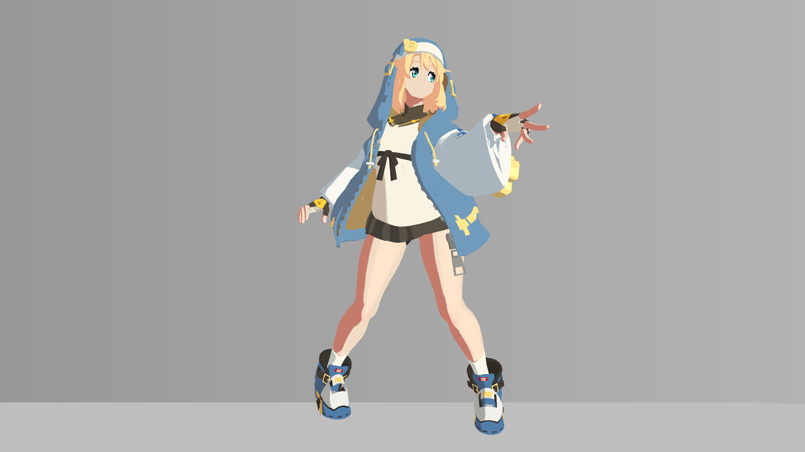
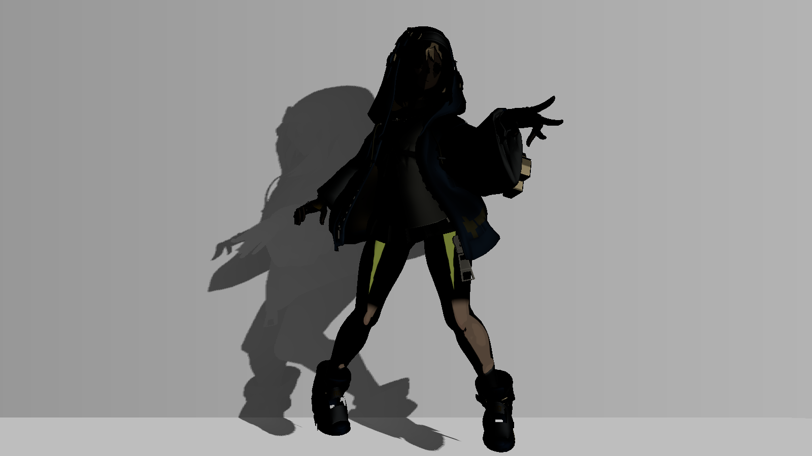

# 09 头发、布料、皮肤和金属的高光区分

> 本章依据磁盘源码与保存数据解释当前实现。所有配图均为 2026-10-20 历史产物；操作与预期供独立练习，尚未在本次 Unity 运行验证。

## 视觉问题与原理

所有表面用同一个尖亮点，会让皮肤、布料和头发都像塑料。当前方案使用独立 RGBA 分类图，把高光的形状、颜色和强度分开控制：头发有较宽肩部及 ILM.B 画定亮芯，布料是低强度幂函数柔光，皮肤较弱，金属有明显亮芯。

核心方向量为 `nh=saturate(dot(n,normalize(l+v)))`，其中 l+v 的单位方向叫半程向量。较高幂次使亮区更集中；step/smoothstep 的阈值制造更明确的亮带。代码又用 fwidth（像素间信号变化的估计）决定最小过渡，降低硬阈值锯齿。

分类后的基础 spec 是四类 shine×对应遮罩的和，乘主光颜色和旧 band。未分类的眼睛/嘴唇等保留原有后备 spec，并非全图强制替换。ILM.B 是稀疏手绘细节，头发公式将弱底与局部亮芯分开，不能把它解释成整片金属度或粗糙度。

FocusedSpec 随后以新受光带替换分类贡献：它从原 signal 和整理后的 clean/focused 区域重算 focusedSpecBand，排除脸部皮肤的 focused 覆盖，再用 HairGain=1.25、ClothGain=1.2、MetalGain=1.05 和腿部皮肤专用宽亮带更新。ThighLobe 还会进一步替换大腿皮肤高光。因此 Debug26–29只展示基础分材质结果，最终高光必须看13。

## 真实效果与比较边界

| 左图 | 右图 |
|---|---|
| [](../assets/images/stages/03.png) | [](../assets/images/stages/04.png) |
| [](../assets/images/project/specular_debug.png) | — |

- **stages/03.png**：独立演示副本历史原生4K图；非 Debug；固定镜头与站立 cell 00 的累计展示，省略投影、构图和4K线宽与主工程不同。相邻阶段是效果组累计对照，不是所有参数独立实验。原产物 `render_demo_4k_20261020/frames/stage_03/cell_00.png`。原始说明：亮面与暖色阴面; cumulative stage, fixed camera and same standing cell 00; projection intentionally omitted。
- **stages/04.png**：独立演示副本历史原生4K图；非 Debug；固定镜头与站立 cell 00 的累计展示，省略投影、构图和4K线宽与主工程不同。相邻阶段是效果组累计对照，不是所有参数独立实验。原产物 `render_demo_4k_20261020/frames/stage_04/cell_00.png`。原始说明：材质高光; cumulative stage, fixed camera and same standing cell 00; projection intentionally omitted。
- **project/specular_debug.png**：原工程历史验收图；Debug 输出，编号见原始图注。只作本图效果/诊断展示，未有清单授权的单变量配对；不可与演示副本作单变量比较。原产物 `thigh_highlight_20261020/controlled_full_13_on.png`。原始说明：Debug 13 final combined specular。

完整尺寸、哈希和来源映射见[图片附录](../reference/images.md)。本章证据范围：Debug13最终高光；26–29只基础分类分支。

## 源码位置与原文摘录

- [BridgetToon.shader:537–579](../reference/code/BridgetToon.shader.md#l537)：FORWARD / ForwardBase：vert、frag。
- [BridgetToon.shader:605–609](../reference/code/BridgetToon.shader.md#l605)：FORWARD / ForwardBase：vert、frag。

下列均为原文件连续摘录，保留原始代码；只展示局部上下文，**不是独立可编译实现**。完整分支见逐行索引。

用途：核对本章所述计算/写入；来源 [BridgetToon.shader:548–567](../reference/code/BridgetToon.shader.md#l548)。

```hlsl
                float4 specClass=saturate(tex2D(_FourMaterialSpecMask,i.uv.xy))*saturate(_FourMaterialSpecEnabled);
                float specCoverage=saturate(specClass.r+specClass.g+specClass.b+specClass.a);
                float shineAA=max(fwidth(nh)*0.65,0.006);
                float paintedShine=saturate(ilm.b);
                float hairShoulder=smoothstep(1.0-_HairShineWidth-shineAA,1.0-_HairShineWidth+shineAA,nh);
                float hairCore=smoothstep(1.0-_HairShineWidth*0.28-shineAA,1.0-_HairShineWidth*0.28+shineAA,nh);
                // ILM.B is sparse authored highlight detail, not whole-surface
                // reflectance. A weak base and localized painted core stay separate.
                float hairShape=0.22*hairShoulder+0.78*paintedShine*(0.4*hairShoulder+0.6*hairCore);
                half3 shineHair=lerp(albedo,_HairShineTint.rgb,0.32)*_HairShineStrength*hairShape;
                float clothShape=pow(nh,max(_ClothShinePower,2.0))*(0.30+0.70*paintedShine);
                half3 shineCloth=albedo*_ClothShineTint.rgb*_ClothShineStrength*clothShape;
                float skinShape=pow(nh,max(_SkinShinePower,4.0))*(0.25+0.75*paintedShine);
                half3 shineSkin=lerp(albedo,_SkinShineTint.rgb,0.12)*_SkinShineStrength*skinShape;
                float metalShoulder=smoothstep(1.0-_MetalShineWidth-shineAA,1.0-_MetalShineWidth+shineAA,nh);
                float metalCore=smoothstep(1.0-_MetalShineWidth*0.23-shineAA,1.0-_MetalShineWidth*0.23+shineAA,nh);
                float metalShape=(0.23*metalShoulder+0.77*metalCore)*(0.55+0.45*paintedShine);
                half3 shineMetal=lerp(albedo,half3(1,1,1),0.38)*_MetalShineTint.rgb*_MetalShineStrength*metalShape;
                half3 classifiedSpec=(shineHair*specClass.r+shineCloth*specClass.g+shineSkin*specClass.b+shineMetal*specClass.a)*_LightColor0.rgb*band;
                spec=spec*(1.0-specCoverage)+classifiedSpec;
```

用途：核对本章所述计算/写入；来源 [BridgetToon.shader:572–579](../reference/code/BridgetToon.shader.md#l572)。

```hlsl
                float focusedUnoccluded=smoothstep(_LightTreshold-soft,_LightTreshold+soft,signal);
                float focusedRegional=(cleanFaceBand*faceRegionMask+focusedSkinBand*bodySkinRegion+cleanSleeveBand*sleeveRegion+focusedTunicBand*tunicRegion+cleanClothBand*cleanOtherCloth)/max(cleanTotal,0.0001);
                float focusedSpecBand=lerp(focusedUnoccluded,focusedRegional,saturate(_CleanShadeEnabled)*cleanCoverage);
                float focusedSkinAA=max(fwidth(nh)*0.65,0.008);
                float focusedSkinShoulder=smoothstep(1.0-_FocusedSkinWidth-focusedSkinAA,1.0-_FocusedSkinWidth+focusedSkinAA,nh);
                float focusedSkinCore=smoothstep(1.0-_FocusedSkinWidth*0.45-focusedSkinAA,1.0-_FocusedSkinWidth*0.45+focusedSkinAA,nh);
                half3 focusedSkinShine=lerp(albedo,_SkinShineTint.rgb,0.12)*_FocusedSkinStrength*(0.8*focusedSkinShoulder+0.2*focusedSkinCore)*(0.7+0.3*paintedShine);
                focusedSkinShine=lerp(shineSkin,focusedSkinShine,focusedLegDomain*(1.0-head));
```

用途：核对本章所述计算/写入；来源 [BridgetToon.shader:605–609](../reference/code/BridgetToon.shader.md#l605)。

```hlsl
                float4 focusedClasses=specClass*float4(1,1,1.0-faceRegionMask,1);
                float focusedSpecCoverage=saturate(dot(focusedClasses,float4(1,1,1,1)));
                half3 focusedOldSpec=(shineHair*focusedClasses.r+shineCloth*focusedClasses.g+shineSkin*focusedClasses.b+shineMetal*focusedClasses.a)*_LightColor0.rgb*band;
                half3 focusedNewSpec=(shineHair*_FocusedHairGain*focusedClasses.r+shineCloth*_FocusedClothGain*focusedClasses.g+focusedSkinShine*focusedClasses.b+shineMetal*_FocusedMetalGain*focusedClasses.a)*_LightColor0.rgb*focusedSpecBand;
                spec+=(focusedNewSpec-focusedOldSpec)*saturate(_FocusedSpecEnabled);
```

## 输入合同与脚本依赖

FourMaterialSpecMask.R/G/B/A=发/布/皮/金属，ILM.B=高光细节，NORMAL、视线、主光方向、bodySkin/faceRegion 及 clean/focused band。保存的四主体 _FourMaterialSpecEnabled、_FocusedSpecEnabled 都为1。

基础强度/形状：头发0.12/宽0.1，布料0.035/幂12，皮肤0.028/幂28，金属0.38/宽0.1。FocusedSkinStrength=0.14、Width=0.22。它们都不是物理 BRDF 测量参数。颜色类型与具体值保留在下表，不要拿旧 _BodySpecular*、_HeadSpecular* 当最终分类区域主要旋钮。

## 当前参数：默认值与保存值

以下从 material_parameters.csv 自动提取，B=Base、S=BaseSecondary、F=BodyBaseFlip、C=CoatExterior；“未保存”表示字段不存在。类型及默认来自声明记录，保存值来自磁盘，**不是运行中逐帧采样**。MPB/Global 和内部覆盖见[覆盖附录](../reference/overrides.md)，完整账本见[参数附录](../reference/parameters.md)。

| 属性 | 类型 | 默认 | B 保存 | S 保存 | F 保存 | C 保存 |
|---|---|---|---|---|---|---|
| _FocusedSpecEnabled | Range(0,1) | 0.0 | 1 | 1 | 1 | 1 |
| _FocusedSkinStrength | Range(0,0.4) | 0.14 | 0.14 | 0.14 | 0.14 | 0.14 |
| _FocusedSkinWidth | Range(0.02,0.4) | 0.22 | 0.22 | 0.22 | 0.22 | 0.22 |
| _FocusedHairGain | Range(0,2) | 1.25 | 1.25 | 1.25 | 1.25 | 1.25 |
| _FocusedClothGain | Range(0,2) | 1.2 | 1.2 | 1.2 | 1.2 | 1.2 |
| _FocusedMetalGain | Range(0,2) | 1.05 | 1.05 | 1.05 | 1.05 | 1.05 |
| _FourMaterialSpecMask | 2D | "black" | {"path": "Assets/GGST_Imitate/SpecularRefinement/BGT_SpecularClassMask.png", "scale": {"x": 1, "y": 1}, "offset": {"x": 0, "y": 0}} | {"path": "Assets/GGST_Imitate/SpecularRefinement/BGT_SpecularClassMask.png", "scale": {"x": 1, "y": 1}, "offset": {"x": 0, "y": 0}} | {"path": "Assets/GGST_Imitate/SpecularRefinement/BGT_SpecularClassMask.png", "scale": {"x": 1, "y": 1}, "offset": {"x": 0, "y": 0}} | {"path": "Assets/GGST_Imitate/SpecularRefinement/BGT_SpecularClassMask.png", "scale": {"x": 1, "y": 1}, "offset": {"x": 0, "y": 0}} |
| _FourMaterialSpecEnabled | Range(0,1) | 0.0 | 1 | 1 | 1 | 1 |
| _HairShineStrength | Range(0,0.5) | 0.12 | 0.12 | 0.12 | 0.12 | 0.12 |
| _HairShineWidth | Range(0.02,0.3) | 0.1 | 0.1 | 0.1 | 0.1 | 0.1 |
| _HairShineTint | Color | [1.0, 0.94, 0.78, 1.0] | {"r": 1, "g": 0.94, "b": 0.78, "a": 1} | {"r": 1, "g": 0.94, "b": 0.78, "a": 1} | {"r": 1, "g": 0.94, "b": 0.78, "a": 1} | {"r": 1, "g": 0.94, "b": 0.78, "a": 1} |
| _ClothShineStrength | Range(0,0.2) | 0.035 | 0.035 | 0.035 | 0.035 | 0.035 |
| _ClothShinePower | Range(2,40) | 12.0 | 12 | 12 | 12 | 12 |
| _ClothShineTint | Color | [0.9, 0.95, 1.0, 1.0] | {"r": 0.9, "g": 0.95, "b": 1, "a": 1} | {"r": 0.9, "g": 0.95, "b": 1, "a": 1} | {"r": 0.9, "g": 0.95, "b": 1, "a": 1} | {"r": 0.9, "g": 0.95, "b": 1, "a": 1} |
| _SkinShineStrength | Range(0,0.2) | 0.028 | 0.028 | 0.028 | 0.028 | 0.028 |
| _SkinShinePower | Range(4,80) | 28.0 | 28 | 28 | 28 | 28 |
| _SkinShineTint | Color | [1.0, 0.82, 0.68, 1.0] | {"r": 1, "g": 0.82, "b": 0.68, "a": 1} | {"r": 1, "g": 0.82, "b": 0.68, "a": 1} | {"r": 1, "g": 0.82, "b": 0.68, "a": 1} | {"r": 1, "g": 0.82, "b": 0.68, "a": 1} |
| _MetalShineStrength | Range(0,1) | 0.38 | 0.38 | 0.38 | 0.38 | 0.38 |
| _MetalShineWidth | Range(0.02,0.3) | 0.1 | 0.1 | 0.1 | 0.1 | 0.1 |
| _MetalShineTint | Color | [1.0, 0.97, 0.9, 1.0] | {"r": 1, "g": 0.97, "b": 0.9, "a": 1} | {"r": 1, "g": 0.97, "b": 0.9, "a": 1} | {"r": 1, "g": 0.97, "b": 0.9, "a": 1} | {"r": 1, "g": 0.97, "b": 0.9, "a": 1} |
| _SpecularPower | Range(1,100) | 24.0 | 15 | 15 | 15 | 15 |
| _SpecularIntensity | Range(0,2) | 0.12 | 0.12 | 0.12 | 0.12 | 0.12 |

## 独立练习的操作步骤

1. 在练习副本先用25确认分类：R/G/B分别偏红/绿/蓝，金属A合到RGB显示白色。它不是原始RGBA逐通道图，也不证明类别没有重叠。
2. 固定相机、主光与姿势，输出13，看最终高光；再用26–29理解基础分类形状，避免把后者当最终。
3. 每次只调整一类的强度或宽度/幂次，先确认其余材质不变；分类串色时先修自己遮罩而非补参数。
4. 切 _FocusedSpecEnabled 进行同条件比较，尤其观察腿部和布料。保持 Palette 和 diffuse 开关不动。
5. 回0检查高光不会抹去内部线，确认眼睛原白点未被分类覆盖；需要追踪大腿亮块时进入10章。

## 如何验收与排错

预期布料较柔且弱、金属有亮芯、头发亮区含手绘细节、皮肤不整片发白。13是最后 spec；若26–29有光而13不同，先检查Focused/Thigh替换。若材质边界出现异常叠加，检查分类图通道重叠与压缩。

阶段03→04是材质高光累计展示，specular_debug 为历史Debug13。待补：最终版本下每类开关独立对照、当前分类图的原像素审计；本包没有原图，不可用自动生成遮罩冒充。

## 依赖及相互影响

高光不由 Palette 直接着色，却受 albedo、主光和 band/区域信号影响。ThighLobe 与 FocusedSpec 在分类皮肤内合成；ReferenceRim 复用同一分类图但有独立亮度。内部线在合成以后叠加，改变墨线也会改变亮区的观感。

[返回章节导航](../index.md) · [章节—证据表](../reference/evidence-map.md) · [依赖接口](../reference/dependencies.md)
