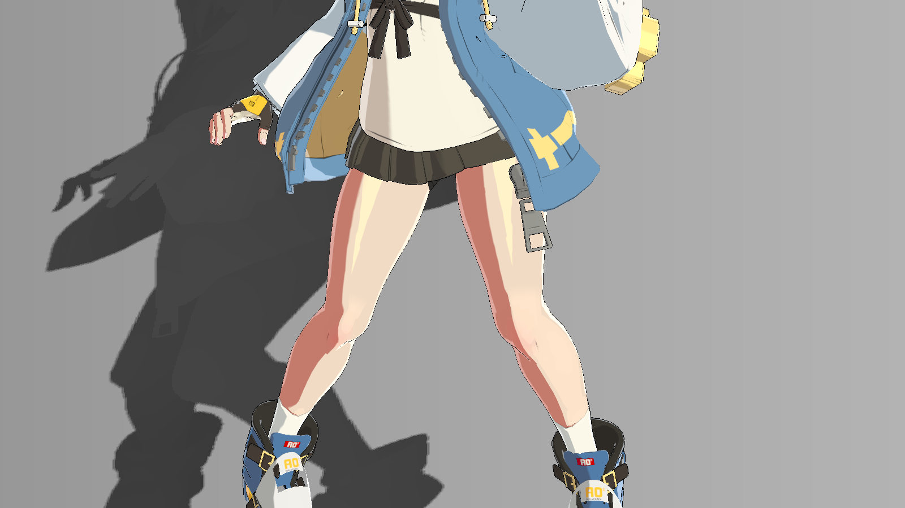
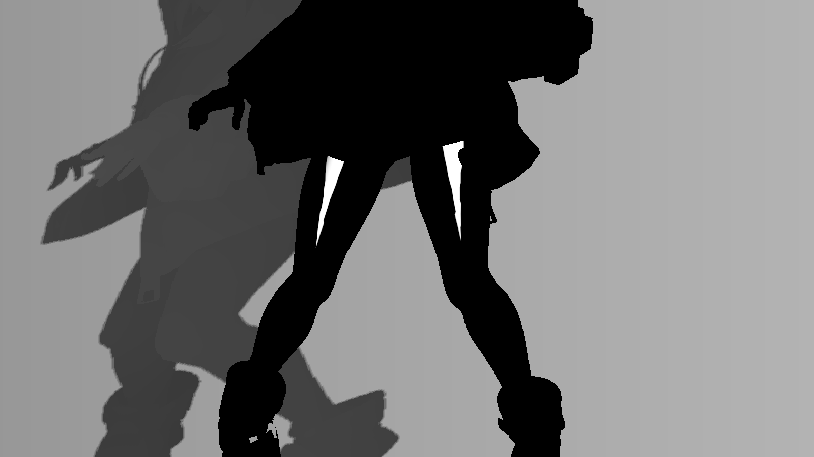

# 10 大腿高光的范围、形状与颜色

> 主体依据不可变源码与保存数据；原配图为2026-10-20历史产物。2026-10-21新增的隔离Unity静态实验单独标注，仅其所列条件已实测，其他独立练习/Play验证仍待补。

## 视觉问题与原理

大腿需要一块稳定、收尖、带浅金色倾向的局部亮形，而不是追着半程向量到处跑的普通点高光。当前实现以图集坐标定义亮块形状，再以视向和光向控制可见度。这是针对当前角色 UV 的艺术绘制式近似。

坐标为 p=(u×2048,(1-v)×2048)。腿域 x=200…510、y=880…1195；沿 y 的前侧中心不是直线：从357.89起分段修正，在 y≈981附近改变走向，以适应原图集环带。完整中心系数见583–594行，不应概括成“任何模型沿UV竖线即可”。

收尖由 `t=saturate((p.y-918)/82)`、`halfWidth=7.2*(1-pow(t,1.15))` 定义。横向距离减去半宽，再用 fwidth 自适应平滑得到 lobe；y≈916–1001限制亮块纵向。朝向门控为 smoothstep(0.2,0.55,nv)×smoothstep(0.50,0.68,nl)，这里 nl 是半兰伯特值，不是原始 N·L。

亮块值为 tint×strength×lobe×facing，但替换域 thighReplace 比亮块宽得多，并在 y1015–1030前收掉；域内旧腿部皮肤高光被替换，即使域中 lobe=0，也会清理旧散光。最后只有 _FocusedSpecEnabled 参与的分类皮肤差值才能把结果送入 spec；不能把 _ThighLobeEnabled 当完全独立的最终高光开关。

## 真实效果与比较边界

| 左图 | 右图 |
|---|---|
| [](../assets/images/stages/04.png) | [](../assets/images/stages/05.png) |
| [](../assets/images/project/thigh_before.png) | [](../assets/images/project/thigh_after.png) |
| [](../assets/images/project/thigh_lobe_debug.png) | — |

- **stages/04.png**：独立演示副本历史原生4K图；非 Debug；固定镜头与站立 cell 00 的累计展示，省略投影、构图和4K线宽与主工程不同。相邻阶段是效果组累计对照，不是所有参数独立实验。原产物 `render_demo_4k_20261020/frames/stage_04/cell_00.png`。原始说明：材质高光; cumulative stage, fixed camera and same standing cell 00; projection intentionally omitted。
- **stages/05.png**：独立演示副本历史原生4K图；非 Debug；固定镜头与站立 cell 00 的累计展示，省略投影、构图和4K线宽与主工程不同。相邻阶段是效果组累计对照，不是所有参数独立实验。原产物 `render_demo_4k_20261020/frames/stage_05/cell_00.png`。原始说明：大腿高光; cumulative stage, fixed camera and same standing cell 00; projection intentionally omitted。
- **project/thigh_before.png**：原工程历史验收图；非 Debug。清单记录为 thigh lobe OFF/ON 控制对；本次未重跑。原产物 `thigh_highlight_20261020/controlled_body_0_off.png`。原始说明：controlled thigh lobe disabled; paired with thigh_after。
- **project/thigh_after.png**：原工程历史验收图；非 Debug。清单记录为 thigh lobe OFF/ON 控制对；本次未重跑。原产物 `thigh_highlight_20261020/controlled_body_0_on.png`。原始说明：controlled thigh lobe enabled; paired with thigh_before。
- **project/thigh_lobe_debug.png**：原工程历史验收图；Debug 输出，编号见原始图注。只作本图效果/诊断展示，未有清单授权的单变量配对；不可与演示副本作单变量比较。原产物 `thigh_highlight_20261020/controlled_body_44_on.png`。原始说明：Debug 44 thigh lobe and facing gates。

完整尺寸、哈希和来源映射见[图片附录](../reference/images.md)。本章证据范围：历史受控OFF/ON与Debug44；新UV复测待补。

## 源码位置与原文摘录

- [BridgetToon.shader:507–518](../reference/code/BridgetToon.shader.md#l507)：FORWARD / ForwardBase：vert、frag。
- [BridgetToon.shader:580–609](../reference/code/BridgetToon.shader.md#l580)：FORWARD / ForwardBase：vert、frag。

下列均为原文件连续摘录，保留原始代码；只展示局部上下文，**不是独立可编译实现**。完整分支见逐行索引。

用途：核对本章所述计算/写入；来源 [BridgetToon.shader:583–603](../reference/code/BridgetToon.shader.md#l583)。

```hlsl
                float thighT=saturate((palettePixel.y-918.0)/82.0);
                // Follow the measured anterior meridian of the original UV island;
                // its ring spacing bends at y=981, so a straight UV line is not
                // a straight line on the existing thigh surface.
                float thighCenter=357.89;
                thighCenter+=(-0.44)*saturate((palettePixel.y-916.85)/11.84);
                thighCenter+=(-1.35)*saturate((palettePixel.y-928.69)/12.07);
                thighCenter+=(-1.70)*saturate((palettePixel.y-940.76)/13.24);
                thighCenter+=(-1.90)*saturate((palettePixel.y-954.0)/13.74);
                thighCenter+=(4.90)*saturate((palettePixel.y-967.74)/13.89);
                thighCenter+=(-1.30)*saturate((palettePixel.y-981.63)/9.42);
                thighCenter+=(-1.24)*saturate((palettePixel.y-991.05)/9.62);
                float thighHalfWidth=7.2*(1.0-pow(thighT,1.15));
                float thighEdge=thighHalfWidth-abs(palettePixel.x-thighCenter);
                float thighAA=max(fwidth(thighEdge)*0.65,0.35);
                float thighLobe=smoothstep(-thighAA,thighAA,thighEdge);
                thighLobe*=smoothstep(916.0,920.0,palettePixel.y)*(1.0-smoothstep(998.0,1001.0,palettePixel.y));
                float thighReplace=focusedLegDomain*(1.0-head)*(1.0-smoothstep(1015.0,1030.0,palettePixel.y));
                float thighFacing=smoothstep(0.2,0.55,nv)*smoothstep(0.50,0.68,nl);
                half3 thighShine=_ThighLobeTint.rgb*_ThighLobeStrength*thighLobe*thighFacing;
                focusedSkinShine=lerp(focusedSkinShine,thighShine,thighReplace*saturate(_ThighLobeEnabled));
```

用途：核对本章所述计算/写入；来源 [BridgetToon.shader:605–609](../reference/code/BridgetToon.shader.md#l605)。

```hlsl
                float4 focusedClasses=specClass*float4(1,1,1.0-faceRegionMask,1);
                float focusedSpecCoverage=saturate(dot(focusedClasses,float4(1,1,1,1)));
                half3 focusedOldSpec=(shineHair*focusedClasses.r+shineCloth*focusedClasses.g+shineSkin*focusedClasses.b+shineMetal*focusedClasses.a)*_LightColor0.rgb*band;
                half3 focusedNewSpec=(shineHair*_FocusedHairGain*focusedClasses.r+shineCloth*_FocusedClothGain*focusedClasses.g+focusedSkinShine*focusedClasses.b+shineMetal*_FocusedMetalGain*focusedClasses.a)*_LightColor0.rgb*focusedSpecBand;
                spec+=(focusedNewSpec-focusedOldSpec)*saturate(_FocusedSpecEnabled);
```

## 输入合同与脚本依赖

当前图集坐标、分类图B皮肤、bodySkinRegion、head=0、nv、nl、主光颜色与 focusedSpecBand。四主体 _ThighLobeEnabled=1、Strength=0.16、Tint 为 Color(0.92,1,0.45,1)。这是浅金方向的参数，不是屏幕像素RGB(0.92,1,0.45)。

四材质开关相同不代表头/衣服都会出现亮块，UV域、皮肤分类和头体门控共同限制。换UV需重新设计中心曲线、宽度、纵向窗口、替换范围及膝盖过渡；不得通过修改当前网格/Bind Pose 来迁就这一章。

## 当前参数：默认值与保存值

以下从 material_parameters.csv 自动提取，B=Base、S=BaseSecondary、F=BodyBaseFlip、C=CoatExterior；“未保存”表示字段不存在。类型及默认来自声明记录，保存值来自磁盘，**不是运行中逐帧采样**。MPB/Global 和内部覆盖见[覆盖附录](../reference/overrides.md)，完整账本见[参数附录](../reference/parameters.md)。

| 属性 | 类型 | 默认 | B 保存 | S 保存 | F 保存 | C 保存 |
|---|---|---|---|---|---|---|
| _ThighLobeEnabled | Range(0,1) | 0.0 | 1 | 1 | 1 | 1 |
| _ThighLobeStrength | Range(0,0.4) | 0.16 | 0.16 | 0.16 | 0.16 | 0.16 |
| _ThighLobeTint | Color | [0.92, 1.0, 0.45, 1.0] | {"r": 0.92, "g": 1, "b": 0.45, "a": 1} | {"r": 0.92, "g": 1, "b": 0.45, "a": 1} | {"r": 0.92, "g": 1, "b": 0.45, "a": 1} | {"r": 0.92, "g": 1, "b": 0.45, "a": 1} |
| _FocusedSpecEnabled | Range(0,1) | 0.0 | 1 | 1 | 1 | 1 |
| _FocusedThighThreshold | Range(0.3,0.8) | 0.57 | 0.57 | 0.57 | 0.57 | 0.57 |
| _FocusedCalfThreshold | Range(0.3,0.8) | 0.59 | 0.59 | 0.59 | 0.59 | 0.59 |
| _FocusedKneeThreshold | Range(0.3,0.8) | 0.62 | 0.62 | 0.62 | 0.62 | 0.62 |
| _FocusedSkinStrength | Range(0,0.4) | 0.14 | 0.14 | 0.14 | 0.14 | 0.14 |
| _FocusedSkinWidth | Range(0.02,0.4) | 0.22 | 0.22 | 0.22 | 0.22 | 0.22 |

## 独立练习的操作步骤

1. 在练习副本先确认22的身体皮肤与25的皮肤分类；再看40是否只覆盖自己的目标腿域。换图集未适配时，先把本章标为待补。
2. 用43看替换域，44看亮形×朝向；注意这两个诊断公式没有乘 _ThighLobeEnabled，只用于看域，不是开关状态证明。
3. 固定姿势、FocusedSpec=1，切换 _ThighLobeEnabled，保存0和13的同条件对照。
4. 先核形状与膝盖边界，再调 strength/tint；不要用全局 SkinShineStrength 代替局部亮形控制。
5. 在站立循环中逐姿态检查前侧亮块是否黏在正确表面、下端是否越过膝盖；同时看视向/光向变化是否合理。

## 如何验收与排错

thigh_before/after 是清单明确标注的历史受控OFF/ON，允许并排展示；thigh_lobe_debug 是44，只显示几何域和朝向，不是最终颜色。阶段04→05为累计展示。

如果整腿出现色带，查替换域和分类；如果44有形而13没有，查开关、FocusedSpec、分类皮肤与光带；如果亮块扭曲，先查UV和中心曲线而非骨骼。待补：新UV模型实验、同条件不同光向/视角及站立逐姿态截图。

## 依赖及相互影响

ThighLobe 替换 focusedSkinShine，FocusedSpec 再合并到 spec；两级路径都需理解。FocusedShade 影响腿部受光带，Palette 影响漫反射而非亮块 tint；墨线覆盖与rim也会改变局部对比。

[返回章节导航](../index.md) · [章节—证据表](../reference/evidence-map.md) · [依赖接口](../reference/dependencies.md)
