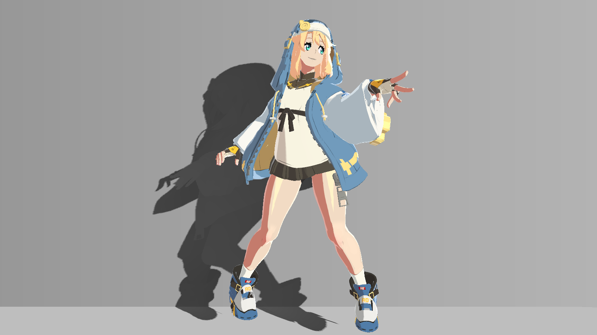

# 整理内部线与外轮廓

内部线说明衣料和五官结构，外轮廓整理剪影。分别控制它们，避免把所有黑色细节都当成同一套描边。

| 对照 | 对照 |
|---|---|
| **原描边，Debug0** [](../assets/images/standing/20261021/cf05441ff809410ab9d47fef6c3b6bc1e2817dfd99e4e5bb01c26d47ecd85937.png) | **只把外描边宽度设为0** [](../assets/images/standing/20261021/c088cfc84e410342a59def227a55fd73e53ff84bcd3b4d207f701be639bdbcf3.png) |

同姿态、同镜头、1600×900、HDR关闭、RT单采样；内部线保留。这个对照用于区分外壳与纹理线。

**Debug31：内部墨线** [](../assets/images/project/ink_debug.png)

## 准备输入

内部线使用ILM.A与分类图；外轮廓使用POSITION、NORMAL、UV、ILM.R、OLM.RGB以及可选TANGENT.xyz。开启_UseSmoothOutline前必须确认网格已保存专用描边法线。

先完成主体颜色、眼睛和边缘光，再在最终Debug0中判断线条轻重。线条对相机距离、输出分辨率和抗锯齿很敏感。

## 在哪里操作

外壳宽度、分类比例、内部强度与墨色均在目标练习材质；TANGENT来自已有网格，不能通过材质开关自动准备。全程用固定Game输出，Debug0看外轮廓，30/31只看内线。

## 操作步骤

1. 在Game视图固定分辨率、相机与抗锯齿，回0。逐张主体材质确认`_OutlineWidth`：Base/Secondary/Coat=0.8，Flip=0。只把一张非零材质暂设0再恢复，预期对应外壳消失、内部纹理线仍在；若看不出，先确认你改的是轮廓可见部位的材质。
2. 使用自己的网格时，在练习材质将`_UseSmoothOutline=0`作为几何法线基线。只有另有证据表明TANGENT.xyz已存专用描边法线，才切1比较；切1后出现尖刺就恢复0。没有提供网格数据，不能保证普通模型得到平滑外壳，也不在这里重写网格。
3. `"材质分区线条启用"`即_LineRefineEnabled设1。在_LineContourWidths的X/Y/Z/W按发/布/肤/金属读取，示例为(0.82,0.95,0.6,0.72)。只把皮肤Z暂设0再恢复0.6，观察已分类皮肤轮廓是否减弱；未分类后备和Flip的0基宽不能据此产生外壳。此分量试验未附独立A/B。
4. 切7看ILM.A，30看覆盖，31看内部墨色，再回Debug0判断强度。30/31没有乘_LineInnerStrengths，改强度时它们不显示最终变化。保持LineRefine=1，只将_LineInnerStrengths皮肤Z从0.58暂设0并恢复，其他X/Y/W不动。预期已分类皮肤内线贡献减弱；若黑线不受影响，先区分贴图本身的暗色、其他材质、外壳或未分类部分。
5. 将_LineInnerFilter从0.6暂设0再恢复，比较31中细线缩小时的覆盖变化。它只过滤Alpha，不要给整张ILM.RGB加模糊或改sRGB。颜色仍由四类Ink、TintMix和OLM参与，先定覆盖再改墨色。
6. 回0恢复所有宽度与强度，播放已有站立循环。31没有外壳是Debug裁剪行为；真正的轮廓判断必须在0。4K示意的临时1.6不写回本章0.8基宽，自己的目标分辨率需要另行观察。

## 原理与代码位置

外轮廓是Cull Front反向壳Pass。屏幕外扩的裁剪坐标增量为`direction*(2*width/_ScreenParams.xy)*clip.w`，width是像素尺度。分类比例由_LineContourWidths/0.8参与；零宽层保持零宽。

内部线覆盖率为`1-saturate(ILM.A)`，只对Alpha做中心加四邻域的屏幕足迹过滤，ILM.RGB仍原样采样。连续覆盖率有助于缩小时保留细线。

线条在diffuse+ambient+rim+spec合成后覆盖；眼睛原白点恢复在内线之后。Debug非0时OUTLINE被裁掉，因此31只能检查内部线，不能检查外轮廓。

- [BridgetToon.shader:625–652](../reference/code/BridgetToon.shader.md#l625)：FORWARD：vert / frag及其计算函数。
- [BridgetToon.shader:729–793](../reference/code/BridgetToon.shader.md#l729)：OUTLINE：vertOutline / fragOutline。

局部摘录（需结合完整上下文）：[BridgetToon.shader:635–652](../reference/code/BridgetToon.shader.md#l635)。

```hlsl
                float rawInk=1.0-saturate(ilm.a);
                // Only Alpha receives screen-footprint filtering. Original ILM
                // RGB lighting and sparse highlight data remain untouched.
                float2 inkDx=ddx(i.uv.xy)*0.28,inkDy=ddy(i.uv.xy)*0.28;
                float filteredInk=0.5*rawInk+0.125*(4.0-
                    tex2D(_LightMap,i.uv.xy+inkDx+inkDy).a-
                    tex2D(_LightMap,i.uv.xy+inkDx-inkDy).a-
                    tex2D(_LightMap,i.uv.xy-inkDx+inkDy).a-
                    tex2D(_LightMap,i.uv.xy-inkDx-inkDy).a);
                // Continuous coverage preserves minified thin painted lines.
                // Unclassified eyes, lips and detail keep the exact old blend.
                float refinedInk=lerp(rawInk,saturate(filteredInk),saturate(_LineInnerFilter));
                float inkStrength=dot(inkClass,_LineInnerStrengths)/max(inkClassTotal,0.0001);
                inkStrength*=_InnerLineStrength/0.65;
                half3 materialInk=(_LineHairInk.rgb*inkClass.r+_LineClothInk.rgb*inkClass.g+
                    _LineSkinInk.rgb*inkClass.b+_LineMetalInk.rgb*inkClass.a)/max(inkClassTotal,0.0001);
                half3 styledInk=lerp(_InnerLineColor.rgb,materialInk,saturate(_LineInnerTintMix));
                color=lerp(color,lerp(lineBaseColor,styledInk,saturate(refinedInk*inkStrength)),inkCoverage);
```

局部摘录（需结合完整上下文）：[BridgetToon.shader:755–771](../reference/code/BridgetToon.shader.md#l755)。

```hlsl
                float layer=tex2Dlod(_LightMap,float4(o.uv,0,0)).r*255.0;
                float skin=step(10.0,layer)*(1.0-step(_LayerMaskStep,layer));
                float3 outlineNormal=normalize(lerp(v.normal,v.smoothNormal.xyz,step(0.5,_UseSmoothOutline)));
                float3 wn=UnityObjectToWorldNormal(outlineNormal);
                float3 vn=mul((float3x3)UNITY_MATRIX_V,wn);
                float2 direction=float2(UNITY_MATRIX_P[0][0]*vn.x,UNITY_MATRIX_P[1][1]*vn.y)*_ScreenParams.xy;
                direction/=max(length(direction),0.0001);
                float width=_OutlineWidth*lerp(1.0,_OutlineSkinScale,skin);
// BEGIN GGST LINE REFINEMENT contour width
                // Reuse the audited class atlas rather than confusing white
                // cloth with low-ILM-R skin. Existing zero-width layers stay off.
                float4 contourClass=saturate(tex2Dlod(_FourMaterialSpecMask,float4(o.uv,0,0)));
                float contourTotal=dot(contourClass,float4(1,1,1,1));
                float styledWidth=_OutlineWidth*dot(contourClass,_LineContourWidths/0.8)/max(contourTotal,0.0001);
                width=lerp(width,styledWidth,saturate(contourTotal)*step(0.5,_LineRefineEnabled));
// END GGST LINE REFINEMENT contour width
                o.pos.xy+=direction*(2.0*width/_ScreenParams.xy)*o.pos.w;
```

局部摘录（需结合完整上下文）：[BridgetToon.shader:774–789](../reference/code/BridgetToon.shader.md#l774)。

```hlsl
            half4 fragOutline(f i):SV_Target
            {
                clip(_OutlineWidth-0.001); clip(0.5-_DebugMode);
                half3 map=tex2D(_OutlineMap,i.uv).rgb;
// BEGIN GGST LINE REFINEMENT contour ink
                if(_LineRefineEnabled>0.5)
                {
                    float4 contourClass=saturate(tex2D(_FourMaterialSpecMask,i.uv));
                    float contourTotal=dot(contourClass,float4(1,1,1,1));
                    half3 materialInk=(_LineHairInk.rgb*contourClass.r+_LineClothInk.rgb*contourClass.g+
                        _LineSkinInk.rgb*contourClass.b+_LineMetalInk.rgb*contourClass.a)/max(contourTotal,0.0001);
                    // OLM is authored sRGB color, not an alpha width mask.
                    // Retain its black/gray region distinction in the new tint.
                    materialInk*=lerp(0.78,1.0,saturate(map.r/0.03310477));
                    half3 originalInk=lerp(_OutlineColor.rgb,map,_OutlineMapStrength);
                    return half4(lerp(originalInk,materialInk,saturate(contourTotal)*saturate(_LineContourTintMix)),1);
```

## 参数怎么调

下表区分Shader默认值与四主体材质设置。Base/Secondary/Flip/Coat对应四种主体材质；同名字段还可能被[MPB或全局输入](../reference/overrides.md)覆盖。完整属性类型和纹理绑定见[参数参考](../reference/parameters.md)。

| 属性 | Inspector名称 | 类型 | Shader默认 | 材质设置 | 作用 |
|---|---|---|---|---|---|
| _OutlineWidth | 轮廓宽度 / 输出像素 | Range(0,4) | 0.8 | Base=0.8；Secondary=0.8；Flip=0；Coat=0.8 | 外轮廓像素基宽；Flip保持0 |
| _UseSmoothOutline | 使用蒙皮平滑描边法线（需专用网格） | Float | 0.0 | 1 | 读取专用TANGENT.xyz，而非普通切线 |
| _OutlineSkinScale | 皮肤轮廓宽度比例 | Range(0,1) | 0.35 | 0.35 | 基础皮肤轮廓缩放 |
| _LineRefineEnabled | 材质分区线条启用 | Float | 0.0 | 1 | 启用分类线条控制 |
| _LineContourWidths | 轮廓像素宽度 发/布/肤/金属 | Vector | [0.82, 0.95, 0.6, 0.72] | (0.82, 0.95, 0.6, 0.72) | 发/布/皮/金属外轮廓比例 |
| _LineInnerStrengths | 内部线强度 发/布/肤/金属 | Vector | [0.72, 0.76, 0.58, 0.72] | (0.72, 0.76, 0.58, 0.72) | 四类内部线覆盖强度 |
| _LineInnerFilter | 内部线覆盖率过滤 | Range(0,1) | 0.6 | 0.6 | Alpha屏幕足迹过滤权重 |
| _LineContourTintMix | 轮廓材质色混合 | Range(0,1) | 0.55 | 0.55 | 外轮廓墨色混合 |
| _LineInnerTintMix | 内部线材质色混合 | Range(0,1) | 0.45 | 0.45 | 内部线墨色混合 |
| _LineHairInk | 发线暖棕 | Color | [0.06, 0.032, 0.015, 1.0] | (0.06, 0.032, 0.015, 1) | 头发分类墨色 |
| _LineClothInk | 布线蓝炭 | Color | [0.023, 0.031, 0.042, 1.0] | (0.023, 0.031, 0.042, 1) | 衣料分类墨色 |
| _LineSkinInk | 肤线暖棕 | Color | [0.1, 0.045, 0.027, 1.0] | (0.1, 0.045, 0.027, 1) | 皮肤分类墨色 |
| _LineMetalInk | 金属线深棕 | Color | [0.04, 0.032, 0.022, 1.0] | (0.04, 0.032, 0.022, 1) | 金属分类墨色 |
| _OutlineColor | 轮廓颜色 | Color | [0.04, 0.03, 0.025, 1.0] | (0.04, 0.03, 0.025, 1) | 后备轮廓墨色 |
| _OutlineMapStrength | olm 颜色参与 | Range(0,1) | 0.6 | 0.6 | OLM参与墨色的权重 |

## 画面判断与排错

刺出的轮廓：查TANGENT语义。材质交界过粗：查分类、基宽和零宽层。Debug图没有外轮廓：先回0。关了外描边仍有黑线：这是内部线，继续查ILM.A。

4K累计示意把轮廓像素宽度放大两倍，不能把其1.6宽度直接写回基准材质。比较不同分辨率前，先确定要保持的是像素宽度还是屏幕占比；在自己的目标设备和抗锯齿条件下观察细线，不以网页缩放代替Unity画面判断。

内部强度变了但30/31不变是预期：这两个诊断返回过滤覆盖与墨色，没有乘inkStrength。调_LineInnerStrengths或_InnerLineStrength要回Debug0观察，不能按31亮度判断该强度是否生效。

[上一步：添加受控边缘光](13.md) · [下一步：排查站立循环中的画面问题](14.md) · [教程导航](../index.md)
