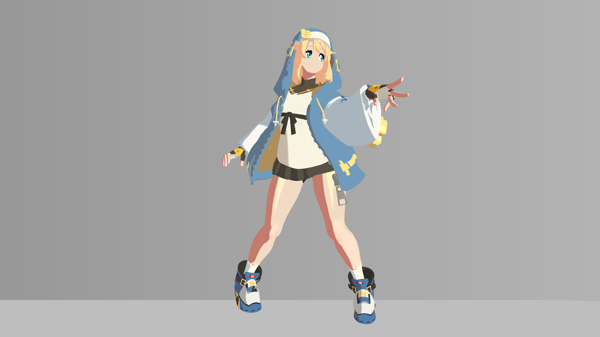
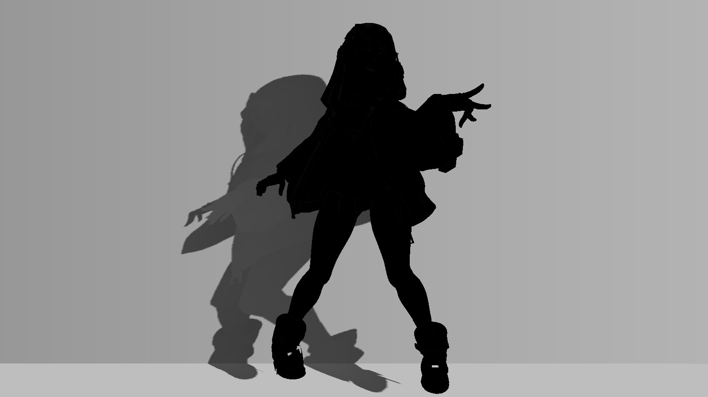

# 11 外轮廓描边与内部线条

> 主体依据不可变源码与保存数据；原配图为2026-10-20历史产物。2026-10-21新增的隔离Unity静态实验单独标注，仅其所列条件已实测，其他独立练习/Play验证仍待补。

## 视觉问题与原理

轮廓决定外形，内部线交代表面结构；两者需要独立控制。当前外轮廓是 Cull Front 的反向壳式 Pass，用屏幕方向外扩已有顶点；内部线则由 1-ILM.A 在完成光照后覆盖，不是几何边缘检测。

外扩先把描边法线转到世界/视图，结合投影矩阵和屏幕尺寸求单位像素方向。裁剪坐标增量为 `direction*(2*width/_ScreenParams.xy)*clip.w`，所以 width 表示屏幕像素尺度，不是世界米。材质分类再以 _LineContourWidths/0.8 缩放宽度，保留原宽度为0的层。

内部线 rawInk=1-saturate(ILM.A)。只对 Alpha 做中心加四邻域的屏幕足迹过滤，避免把 ILM.RGB 的受光/高光信号一并糊掉。refinedInk 由 _LineInnerFilter 混合；连续覆盖率保留缩小时的细线，不把数据 Alpha 当透明度。

最终先合成 diffuse+ambient+rim+spec，再按分类墨色和强度覆盖线；高光/rim因此不会简单抹掉墨线。未分类眼睛/嘴唇保留旧混合。OUTLINE 在 Debug>0.5 时被 clip，不能从 Debug31 推断外轮廓宽度。

## 真实效果与比较边界

| 左图 | 右图 |
|---|---|
| [](../assets/images/stages/05.png) | [](../assets/images/stages/06.png) |
| [](../assets/images/project/ink_debug.png) | — |

- **stages/05.png**：独立演示副本历史原生4K图；非 Debug；固定镜头与站立 cell 00 的累计展示，省略投影、构图和4K线宽与主工程不同。相邻阶段是效果组累计对照，不是所有参数独立实验。原产物 `render_demo_4k_20261020/frames/stage_05/cell_00.png`。原始说明：大腿高光; cumulative stage, fixed camera and same standing cell 00; projection intentionally omitted。
- **stages/06.png**：独立演示副本历史原生4K图；非 Debug；固定镜头与站立 cell 00 的累计展示，省略投影、构图和4K线宽与主工程不同。相邻阶段是效果组累计对照，不是所有参数独立实验。原产物 `render_demo_4k_20261020/frames/stage_06/cell_00.png`。原始说明：描边与内部线条; cumulative stage, fixed camera and same standing cell 00; projection intentionally omitted。
- **project/ink_debug.png**：原工程历史验收图；Debug 输出，编号见原始图注。只作本图效果/诊断展示，未有清单授权的单变量配对；不可与演示副本作单变量比较。原产物 `thigh_highlight_20261020/controlled_full_31_on.png`。原始说明：Debug 31 styled internal lines。

完整尺寸、哈希和来源映射见[图片附录](../reference/images.md)。本章证据范围：Debug31内部线；无本次网格TANGENT审计。

## 源码位置与原文摘录

- [BridgetToon.shader:625–652](../reference/code/BridgetToon.shader.md#l625)：FORWARD / ForwardBase：vert、frag。
- [BridgetToon.shader:729–793](../reference/code/BridgetToon.shader.md#l729)：OUTLINE：vertOutline、fragOutline（范围跨末尾时亦包含SHADOWCASTER）。

下列均为原文件连续摘录，保留原始代码；只展示局部上下文，**不是独立可编译实现**。完整分支见逐行索引。

用途：核对本章所述计算/写入；来源 [BridgetToon.shader:635–652](../reference/code/BridgetToon.shader.md#l635)。

```hlsl
                float rawInk=1.0-saturate(ilm.a);
                // Only Alpha receives screen-footprint filtering. Original ILM
                // RGB lighting and sparse highlight data remain untouched.
                float2 inkDx=ddx(i.uv.xy)*0.28,inkDy=ddy(i.uv.xy)*0.28;
                float filteredInk=0.5*rawInk+0.125*(4.0-
                    tex2D(_LightMap,i.uv.xy+inkDx+inkDy).a-
                    tex2D(_LightMap,i.uv.xy+inkDx-inkDy).a-
                    tex2D(_LightMap,i.uv.xy-inkDx+inkDy).a-
                    tex2D(_LightMap,i.uv.xy-inkDx-inkDy).a);
                // Continuous coverage preserves minified thin painted lines.
                // Unclassified eyes, lips and detail keep the exact old blend.
                float refinedInk=lerp(rawInk,saturate(filteredInk),saturate(_LineInnerFilter));
                float inkStrength=dot(inkClass,_LineInnerStrengths)/max(inkClassTotal,0.0001);
                inkStrength*=_InnerLineStrength/0.65;
                half3 materialInk=(_LineHairInk.rgb*inkClass.r+_LineClothInk.rgb*inkClass.g+
                    _LineSkinInk.rgb*inkClass.b+_LineMetalInk.rgb*inkClass.a)/max(inkClassTotal,0.0001);
                half3 styledInk=lerp(_InnerLineColor.rgb,materialInk,saturate(_LineInnerTintMix));
                color=lerp(color,lerp(lineBaseColor,styledInk,saturate(refinedInk*inkStrength)),inkCoverage);
```

用途：核对本章所述计算/写入；来源 [BridgetToon.shader:755–771](../reference/code/BridgetToon.shader.md#l755)。

```hlsl
                float layer=tex2Dlod(_LightMap,float4(o.uv,0,0)).r*255.0;
                float skin=step(10.0,layer)*(1.0-step(_LayerMaskStep,layer));
                float3 outlineNormal=normalize(lerp(v.normal,v.smoothNormal.xyz,step(0.5,_UseSmoothOutline)));
                float3 wn=UnityObjectToWorldNormal(outlineNormal);
                float3 vn=mul((float3x3)UNITY_MATRIX_V,wn);
                float2 direction=float2(UNITY_MATRIX_P[0][0]*vn.x,UNITY_MATRIX_P[1][1]*vn.y)*_ScreenParams.xy;
                direction/=max(length(direction),0.0001);
                float width=_OutlineWidth*lerp(1.0,_OutlineSkinScale,skin);
// BEGIN GGST LINE REFINEMENT contour width
                // Reuse the audited class atlas rather than confusing white
                // cloth with low-ILM-R skin. Existing zero-width layers stay off.
                float4 contourClass=saturate(tex2Dlod(_FourMaterialSpecMask,float4(o.uv,0,0)));
                float contourTotal=dot(contourClass,float4(1,1,1,1));
                float styledWidth=_OutlineWidth*dot(contourClass,_LineContourWidths/0.8)/max(contourTotal,0.0001);
                width=lerp(width,styledWidth,saturate(contourTotal)*step(0.5,_LineRefineEnabled));
// END GGST LINE REFINEMENT contour width
                o.pos.xy+=direction*(2.0*width/_ScreenParams.xy)*o.pos.w;
```

用途：核对本章所述计算/写入；来源 [BridgetToon.shader:774–789](../reference/code/BridgetToon.shader.md#l774)。

```hlsl
            half4 fragOutline(f i):SV_Target
            {
                clip(_OutlineWidth-0.001); clip(0.5-_DebugMode);
                half3 map=tex2D(_OutlineMap,i.uv).rgb;
// BEGIN GGST LINE REFINEMENT contour ink
                if(_LineRefineEnabled>0.5)
                {
                    float4 contourClass=saturate(tex2D(_FourMaterialSpecMask,i.uv));
                    float contourTotal=dot(contourClass,float4(1,1,1,1));
                    half3 materialInk=(_LineHairInk.rgb*contourClass.r+_LineClothInk.rgb*contourClass.g+
                        _LineSkinInk.rgb*contourClass.b+_LineMetalInk.rgb*contourClass.a)/max(contourTotal,0.0001);
                    // OLM is authored sRGB color, not an alpha width mask.
                    // Retain its black/gray region distinction in the new tint.
                    materialInk*=lerp(0.78,1.0,saturate(map.r/0.03310477));
                    half3 originalInk=lerp(_OutlineColor.rgb,map,_OutlineMapStrength);
                    return half4(lerp(originalInk,materialInk,saturate(contourTotal)*saturate(_LineContourTintMix)),1);
```

## 输入合同与脚本依赖

OUTLINE 读 POSITION、NORMAL、TANGENT.xyz、UV0/UV2、ILM.R、OLM.RGB 和分类图；_UseSmoothOutline=1 把 TANGENT.xyz 当平滑描边法线，普通模型标准切线不能自动满足。

四主体保存宽度 Base/BaseSecondary/CoatExterior=0.8，BodyBaseFlip=0；分类宽度Vector=(0.82,0.95,0.6,0.72)，分类内线强度=(0.72,0.76,0.58,0.72)。4K副本将轮廓像素宽度×2是展示条件差异，不能覆盖主工程保存值。材质墨色类型为Color，具体记录见表。

## 当前参数：默认值与保存值

以下从 material_parameters.csv 自动提取，B=Base、S=BaseSecondary、F=BodyBaseFlip、C=CoatExterior；“未保存”表示字段不存在。类型及默认来自声明记录，保存值来自磁盘，**不是运行中逐帧采样**。MPB/Global 和内部覆盖见[覆盖附录](../reference/overrides.md)，完整账本见[参数附录](../reference/parameters.md)。

| 属性 | 类型 | 默认 | B 保存 | S 保存 | F 保存 | C 保存 |
|---|---|---|---|---|---|---|
| _LineRefineEnabled | Float | 0.0 | 1 | 1 | 1 | 1 |
| _LineContourWidths | Vector | [0.82, 0.95, 0.6, 0.72] | {"r": 0.82, "g": 0.95, "b": 0.6, "a": 0.72} | {"r": 0.82, "g": 0.95, "b": 0.6, "a": 0.72} | {"r": 0.82, "g": 0.95, "b": 0.6, "a": 0.72} | {"r": 0.82, "g": 0.95, "b": 0.6, "a": 0.72} |
| _LineContourTintMix | Range(0,1) | 0.55 | 0.55 | 0.55 | 0.55 | 0.55 |
| _LineInnerStrengths | Vector | [0.72, 0.76, 0.58, 0.72] | {"r": 0.72, "g": 0.76, "b": 0.58, "a": 0.72} | {"r": 0.72, "g": 0.76, "b": 0.58, "a": 0.72} | {"r": 0.72, "g": 0.76, "b": 0.58, "a": 0.72} | {"r": 0.72, "g": 0.76, "b": 0.58, "a": 0.72} |
| _LineInnerFilter | Range(0,1) | 0.6 | 0.6 | 0.6 | 0.6 | 0.6 |
| _LineInnerTintMix | Range(0,1) | 0.45 | 0.45 | 0.45 | 0.45 | 0.45 |
| _LineHairInk | Color | [0.06, 0.032, 0.015, 1.0] | {"r": 0.06, "g": 0.032, "b": 0.015, "a": 1} | {"r": 0.06, "g": 0.032, "b": 0.015, "a": 1} | {"r": 0.06, "g": 0.032, "b": 0.015, "a": 1} | {"r": 0.06, "g": 0.032, "b": 0.015, "a": 1} |
| _LineClothInk | Color | [0.023, 0.031, 0.042, 1.0] | {"r": 0.023, "g": 0.031, "b": 0.042, "a": 1} | {"r": 0.023, "g": 0.031, "b": 0.042, "a": 1} | {"r": 0.023, "g": 0.031, "b": 0.042, "a": 1} | {"r": 0.023, "g": 0.031, "b": 0.042, "a": 1} |
| _LineSkinInk | Color | [0.1, 0.045, 0.027, 1.0] | {"r": 0.1, "g": 0.045, "b": 0.027, "a": 1} | {"r": 0.1, "g": 0.045, "b": 0.027, "a": 1} | {"r": 0.1, "g": 0.045, "b": 0.027, "a": 1} | {"r": 0.1, "g": 0.045, "b": 0.027, "a": 1} |
| _LineMetalInk | Color | [0.04, 0.032, 0.022, 1.0] | {"r": 0.04, "g": 0.032, "b": 0.022, "a": 1} | {"r": 0.04, "g": 0.032, "b": 0.022, "a": 1} | {"r": 0.04, "g": 0.032, "b": 0.022, "a": 1} | {"r": 0.04, "g": 0.032, "b": 0.022, "a": 1} |
| _OutlineMap | 2D | "black" | {"path": "Assets/Bridget_Textures/BGT_olm.png", "scale": {"x": 1, "y": 1}, "offset": {"x": 0, "y": 0}} | {"path": "Assets/Bridget_Textures/BGT_olm.png", "scale": {"x": 1, "y": 1}, "offset": {"x": 0, "y": 0}} | {"path": "Assets/Bridget_Textures/BGT_olm.png", "scale": {"x": 1, "y": 1}, "offset": {"x": 0, "y": 0}} | {"path": "Assets/Bridget_Textures/BGT_olm.png", "scale": {"x": 1, "y": 1}, "offset": {"x": 0, "y": 0}} |
| _InnerLineStrength | Range(0,1) | 0.65 | 0.65 | 0.65 | 0.65 | 0.65 |
| _InnerLineColor | Color | [0.035, 0.028, 0.025, 1.0] | {"r": 0.035, "g": 0.028, "b": 0.025, "a": 1} | {"r": 0.035, "g": 0.028, "b": 0.025, "a": 1} | {"r": 0.035, "g": 0.028, "b": 0.025, "a": 1} | {"r": 0.035, "g": 0.028, "b": 0.025, "a": 1} |
| _OutlineWidth | Range(0,4) | 0.8 | 0.8 | 0.8 | 0 | 0.8 |
| _UseSmoothOutline | Float | 0.0 | 1 | 1 | 1 | 1 |
| _OutlineSkinScale | Range(0,1) | 0.35 | 0.35 | 0.35 | 0.35 | 0.35 |
| _OutlineColor | Color | [0.04, 0.03, 0.025, 1.0] | {"r": 0.04, "g": 0.03, "b": 0.025, "a": 1} | {"r": 0.04, "g": 0.03, "b": 0.025, "a": 1} | {"r": 0.04, "g": 0.03, "b": 0.025, "a": 1} | {"r": 0.04, "g": 0.03, "b": 0.025, "a": 1} |
| _OutlineMapStrength | Range(0,1) | 0.6 | 0.6 | 0.6 | 0.6 | 0.6 |

## 独立练习的操作步骤

1. 在独立工程先确认模型是否已有合约要求的 TANGENT 描边法线；若无证据，在练习副本关闭 _UseSmoothOutline 使用几何法线作为降级观察，记录不等价，不改原模型。
2. 回Debug0看外轮廓，固定1080p或自己的基准分辨率，确认BodyBaseFlip等零宽层仍不绘制。
3. 分别调整 _OutlineWidth 与 _LineContourWidths，记录全局基宽和材质比例，避免两个层级同时改后失去归因。
4. 切到7查看Alpha采样，再用30/31观察内线覆盖/墨色；调 _LineInnerFilter、分类强度，不改变ILM.RGB。
5. 恢复0，比较同分辨率近景与全身。额外分辨率测试须明确比较的是像素宽度还是屏占比例，不能混用。

## 如何验收与排错

预期脸部线较轻、衣料结构线清楚、零宽层不产生额外壳，缩小时细线尽量连续。若轮廓朝奇怪方向刺出，查TANGENT语义；若材质边界线过粗，查分类与基宽；若Debug没有外轮廓，这是源码预期。

阶段05→06为线条效果组累计变化；ink_debug是31的内部线展示。待补：TANGENT数值审计、分辨率同屏占对照和手机缩放可读性在Unity中的验证。网站手机排版检查不等于角色线条稳定性测试。

## 依赖及相互影响

线条依赖分类图，OLM只参与墨色。Profile MSAA、相机距离、像素覆盖和压缩都会改变线观感。眼睛原白点恢复在线条之后，但不能据此把眼线误判为高光错误。

[返回章节导航](../index.md) · [章节—证据表](../reference/evidence-map.md) · [依赖接口](../reference/dependencies.md)
