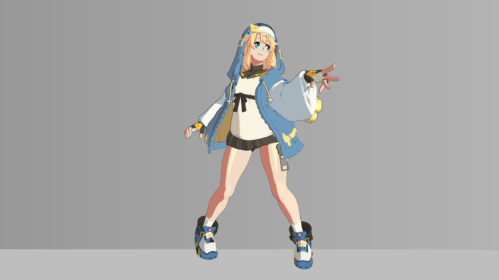
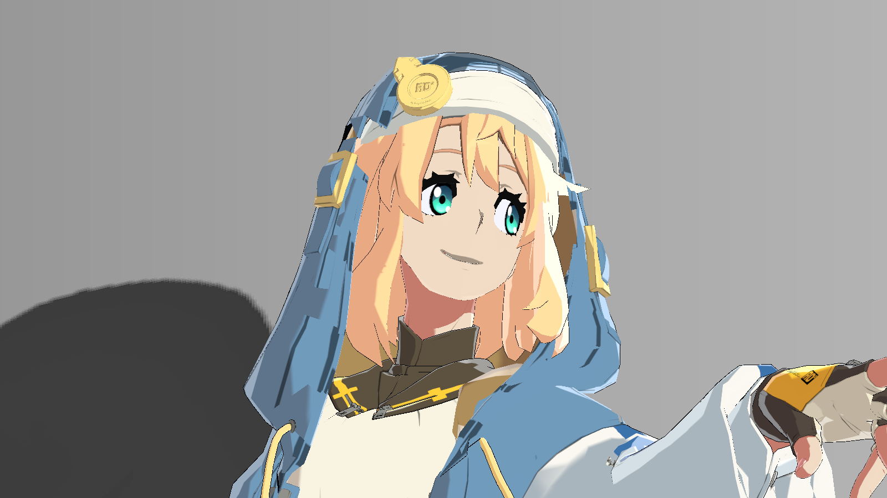
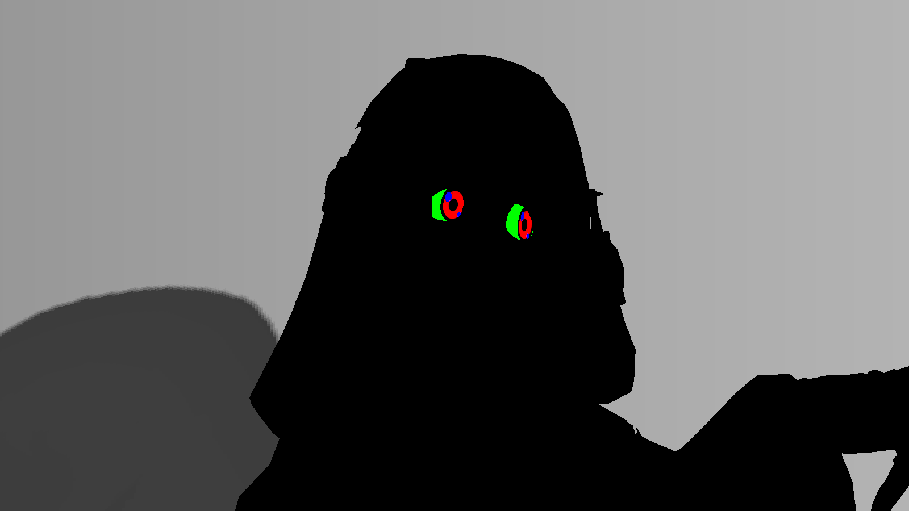

# 12 眼睛层次与高光

> 本章依据磁盘源码与保存数据解释当前实现。所有配图均为 2026-10-20 历史产物；操作与预期供独立练习，尚未在本次 Unity 运行验证。

## 视觉问题与原理

眼睛只需小幅上暗下亮、边缘层次和原白点清晰度，过强会变成自发光贴纸。当前代码不生成时间驱动的闪点，不增加新的运动高光；高细节眼仍保留原有 HeadGlow/HeadDecal 辅助路径。

先把UV换成2048图集像素坐标。小虹膜中心(960,64)、半径(34,34)，大虹膜中心(1152,130)、半径(104,100)；瞳孔另有保护椭圆。EyeDisk 用长度阈值与 fwidth 平滑边缘；色度条件 min(base.g,base.b)-base.r 保护原青色虹膜，不把黑瞳/墨线/白点一起提亮。

眼白只在 x896…1280/y0…256域内，按接近(0.8388,0.8308,0.9301)的颜色选择；这些常量来自当前图集，不能当通用眼白识别器。eyeHead 还要求 _EyeRefineEnabled×_RegionalHead。

漫反射先压暗虹膜上部和外缘，再用原albedo与同一band提亮下部，稍调眼白。最后在内部线之后，将已有白高光向不低于 base×光色×强度的目标混合。原小眼白点中心(938.7075,48.0896)/(983.5789,85.5)，不会随视角产生新点。这些都是当前工程专用数据。

## 真实效果与比较边界

| 左图 | 右图 |
|---|---|
| [](../assets/images/stages/06.png) | [](../assets/images/stages/07.png) |
| [](../assets/images/project/face.png) | [](../assets/images/project/eye_regions.png) |

- **stages/06.png**：独立演示副本历史原生4K图；非 Debug；固定镜头与站立 cell 00 的累计展示，省略投影、构图和4K线宽与主工程不同。相邻阶段是效果组累计对照，不是所有参数独立实验。原产物 `render_demo_4k_20261020/frames/stage_06/cell_00.png`。原始说明：描边与内部线条; cumulative stage, fixed camera and same standing cell 00; projection intentionally omitted。
- **stages/07.png**：独立演示副本历史原生4K图；非 Debug；固定镜头与站立 cell 00 的累计展示，省略投影、构图和4K线宽与主工程不同。相邻阶段是效果组累计对照，不是所有参数独立实验。原产物 `render_demo_4k_20261020/frames/stage_07/cell_00.png`。原始说明：眼睛层次与高光; cumulative stage, fixed camera and same standing cell 00; projection intentionally omitted。
- **project/face.png**：原工程历史验收图；非 Debug。只作本图效果/诊断展示，未有清单授权的单变量配对；不可与演示副本作单变量比较。原产物 `thigh_highlight_20261020/controlled_face_0_on.png`。原始说明：historical final face close-up。
- **project/eye_regions.png**：原工程历史验收图；Debug 输出，编号见原始图注。只作本图效果/诊断展示，未有清单授权的单变量配对；不可与演示副本作单变量比较。原产物 `thigh_highlight_20261020/controlled_face_33_on.png`。原始说明：Debug 33 iris/sclera/authored glint regions。

完整尺寸、哈希和来源映射见[图片附录](../reference/images.md)。本章证据范围：Debug33区域；最终同条件局部开关近景待补。

## 源码位置与原文摘录

- [BridgetToon.shader:268–272](../reference/code/BridgetToon.shader.md#l268)：FORWARD / ForwardBase：vert、frag。
- [BridgetToon.shader:332–362](../reference/code/BridgetToon.shader.md#l332)：FORWARD / ForwardBase：vert、frag。
- [BridgetToon.shader:521–529](../reference/code/BridgetToon.shader.md#l521)：FORWARD / ForwardBase：vert、frag。
- [BridgetToon.shader:654–668](../reference/code/BridgetToon.shader.md#l654)：FORWARD / ForwardBase：vert、frag。

下列均为原文件连续摘录，保留原始代码；只展示局部上下文，**不是独立可编译实现**。完整分支见逐行索引。

用途：核对本章所述计算/写入；来源 [BridgetToon.shader:337–353](../reference/code/BridgetToon.shader.md#l337)。

```hlsl
                float2 eyePixel=float2(i.uv.x*2048.0,(1.0-i.uv.y)*2048.0);
                float eyeHead=saturate(_EyeRefineEnabled)*saturate(_RegionalHead);
                float2 eyeSmallQ=(eyePixel-float2(960.0,64.0))/float2(34.0,34.0);
                float2 eyeLargeQ=(eyePixel-float2(1152.0,130.0))/float2(104.0,100.0);
                float eyeSmallDisk=EyeDisk(eyeSmallQ);
                float eyeLargeDisk=EyeDisk(eyeLargeQ);
                float eyeSmallPupil=smoothstep(1.10,1.24,length((eyePixel-float2(960.0,64.0))/float2(13.0,13.0)));
                float eyeLargePupil=smoothstep(1.10,1.24,length((eyePixel-float2(1152.0,129.0))/float2(29.0,35.0)));
                // Bounded original teal chroma protects black pupils/ink and
                // authored white glints, including compressed texture edges.
                float eyeChroma=smoothstep(0.015,0.055,min(base.g,base.b)-base.r);
                float eyeIrisMask=saturate(eyeSmallDisk+eyeLargeDisk)*eyeSmallPupil*eyeLargePupil*eyeChroma*eyeHead;
                float2 eyeQ=lerp(eyeSmallQ,eyeLargeQ,step(1020.0,eyePixel.x));
                float eyeUp=-eyeQ.y; // PNG y increases downwards.
                float eyeUpper=smoothstep(-0.20,0.55,eyeUp);
                float eyeLower=(1.0-smoothstep(-0.35,0.40,eyeUp))*(1.0-smoothstep(0.75,1.0,length(eyeQ)));
                float eyeEdge=smoothstep(0.56,0.94,length(eyeQ));
```

用途：核对本章所述计算/写入；来源 [BridgetToon.shader:361–362](../reference/code/BridgetToon.shader.md#l361)。

```hlsl
                float eyeAuthoredGlint=saturate(EyeDisk((eyePixel-float2(938.7075,48.0896))/float2(12.0,12.0))+EyeDisk((eyePixel-float2(983.5789,85.5))/float2(8.5,8.5)));
                float eyeCatchMask=eyeAuthoredGlint*smoothstep(0.85,0.97,min(base.r,min(base.g,base.b)))*eyeHead;
```

用途：核对本章所述计算/写入；来源 [BridgetToon.shader:521–529](../reference/code/BridgetToon.shader.md#l521)。

```hlsl
// BEGIN GGST EYE REFINEMENT diffuse layers
                half3 eyeBeforeDiffuse=diffuse;
                float eyeDepth=saturate(_EyeIrisUpperDepth*eyeUpper+_EyeIrisEdgeDepth*eyeEdge);
                diffuse*=1.0-eyeIrisMask*eyeDepth;
                // Reuse the original iris hue and the same lit/shadow band.
                // No emission or time-driven sparkle is introduced.
                diffuse+=albedo*half3(0.70,1.0,0.92)*_LightColor0.rgb*_LightIntensity*band*eyeIrisMask*eyeLower*_EyeIrisLowerLift;
                diffuse*=lerp(half3(1,1,1),half3(0.70,0.85,1.0),eyeScleraMask*_EyeScleraShade);
                half3 eyeDiffuseDelta=diffuse-eyeBeforeDiffuse;
```

用途：核对本章所述计算/写入；来源 [BridgetToon.shader:654–657](../reference/code/BridgetToon.shader.md#l654)。

```hlsl
// BEGIN GGST EYE REFINEMENT authored catchlight clarity
                half3 eyeBeforeCatch=color;
                half3 eyeCatchTarget=max(color,base*_LightColor0.rgb*_LightIntensity);
                color=lerp(color,eyeCatchTarget,saturate(_EyeCatchlightLift)*eyeCatchMask);
```

## 输入合同与脚本依赖

Base颜色、UV0或镜像选择后的主UV、_RegionalHead MPB、主光、band；无需新眼睛纹理，但已有图集像素未提供。Base/BaseSecondary 的 _EyeRefineEnabled=1，BodyBaseFlip/CoatExterior=0；还需 head=1 才进区域。

参数为 UpperDepth0.18、LowerLift0.1、EdgeDepth0.08、CatchlightLift0.25、ScleraShade0.06，均为强度范围量，不是眼睛最终屏幕亮度。换图集必须重定虹膜、瞳孔、眼白、原白点域与颜色门控；不能只扩大UV圈而保留原坐标。

## 当前参数：默认值与保存值

以下从 material_parameters.csv 自动提取，B=Base、S=BaseSecondary、F=BodyBaseFlip、C=CoatExterior；“未保存”表示字段不存在。类型及默认来自声明记录，保存值来自磁盘，**不是运行中逐帧采样**。MPB/Global 和内部覆盖见[覆盖附录](../reference/overrides.md)，完整账本见[参数附录](../reference/parameters.md)。

| 属性 | 类型 | 默认 | B 保存 | S 保存 | F 保存 | C 保存 |
|---|---|---|---|---|---|---|
| _EyeRefineEnabled | Range(0,1) | 0.0 | 1 | 1 | 0 | 0 |
| _EyeIrisUpperDepth | Range(0,0.5) | 0.18 | 0.18 | 0.18 | 0.18 | 0.18 |
| _EyeIrisLowerLift | Range(0,0.4) | 0.1 | 0.1 | 0.1 | 0.1 | 0.1 |
| _EyeIrisEdgeDepth | Range(0,0.3) | 0.08 | 0.08 | 0.08 | 0.08 | 0.08 |
| _EyeCatchlightLift | Range(0,0.5) | 0.25 | 0.25 | 0.25 | 0.25 | 0.25 |
| _EyeScleraShade | Range(0,0.2) | 0.06 | 0.06 | 0.06 | 0.06 | 0.06 |
| _RegionalHead | Float | 0.0 | 0 | 0 | 0 | 0 |

## 独立练习的操作步骤

1. 在练习副本先确认头Renderer的 _RegionalHead=1，打开33查看 R虹膜/G眼白/B原白点，判断是否误选眼线或兜帽。
2. 固定同一站立姿势与相机近景，输出34看差值，再回0看实际幅度。不能把差值的亮度当最终增亮幅度。
3. 在 _EyeRefineEnabled 开关之间保存同条件近景；优先保护黑瞳和眼线，再微调上部暗、下部亮。
4. 检查原白点只变清晰，没有新增漂移点；若辅助HeadGlow/Decal存在，保持其材质槽，不批量替换。
5. 换模型时先用自己的遮罩或重新定位数据构建练习方案，明确它是新适配，尚未经本工程验证。

## 如何验收与排错

eye_regions 是历史Debug33，face是历史最终脸部近景；两者是诊断/效果图，不能写成效果开关A/B。阶段06→07同条件累计但变化细微，可点击原尺寸查看，不据微小差异夸大结论。

待补：最终版本同姿势局部开/关近景。本教程没有裁图或修饰；若后续裁切应标明原图及矩形位置。若瞳孔发亮，先查色度/瞳孔保护和sRGB；若整个脸改变，先查head和UV域。

## 依赖及相互影响

眼睛漫反射细化在CleanShade/Focused之后，原白点恢复在线条之后；眼睛不应被材质分类错误覆盖。其提亮仍用旧band，因此Debug10与16边界差异也可能影响观察。

[返回章节导航](../index.md) · [章节—证据表](../reference/evidence-map.md) · [依赖接口](../reference/dependencies.md)
