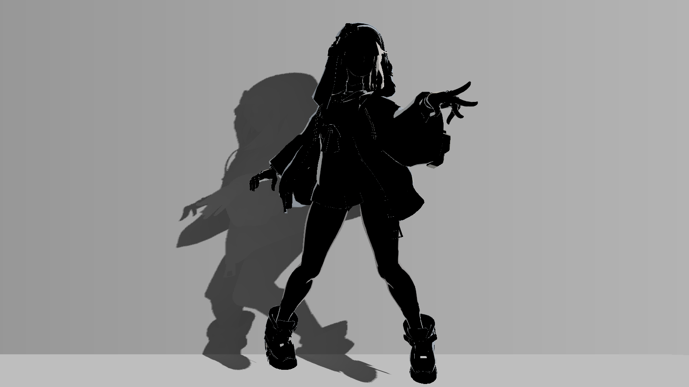

# 13 边缘光

> 主体依据不可变源码与保存数据；原配图为2026-10-20历史产物。2026-10-21新增的隔离Unity静态实验单独标注，后续[站立Play验收](../reference/standing-stability-20261021.md)也单独列出；仅所列条件已实测，其他独立练习/跨环境验证仍待补。

## 视觉问题与原理

边缘光（rim）是在接近轮廓的表面加一层亮色，帮助角色与背景分离；它和高光不是同一个方向函数。当前主要用 nv=saturate(N·V)，nv小代表表面更侧向观察者，再按材质和阴面权重调整。

旧路径用 _RimWidth/_RimIntensity，乘 albedo、band 与主光；分类区域打开 ReferenceRim 后改用 `1-smoothstep(width-aa,width+aa,nv)`，width越大边缘区域越宽。aa=max(fwidth(nv)×0.65,0.008)，减少阈值锯齿。

ReferenceRim 颜色在albedo和 _ReferenceRimTint 之间混合；材质缩放按分类权重平均，脸额外乘 _ReferenceRimFaceScale=0.15。亮度权重 lerp(_ReferenceRimShadowFloor,1,saturate(band)) 使阴面仍保留一部分rim，而不是在阴面全部消失。这是美术描光，不是物理逆光或额外真实灯。

最终 `rim=lerp(oldRim,referenceRim,_ReferenceRimEnabled*specCoverage)`。因此旧 _RimWidth 在未分类/未启用区域仍是后备，但不是最终分类区域的主要宽度控制。

## 真实效果与比较边界

| 左图 | 右图 |
|---|---|
| [](../assets/images/stages/07.png) | [](../assets/images/stages/08.png) |
| [](../assets/images/project/rim_debug.png) | — |

- **stages/07.png**：独立演示副本历史原生4K图；非 Debug；固定镜头与站立 cell 00 的累计展示，省略投影、构图和4K线宽与主工程不同。相邻阶段是效果组累计对照，不是所有参数独立实验。原产物 `render_demo_4k_20261020/frames/stage_07/cell_00.png`。原始说明：眼睛层次与高光; cumulative stage, fixed camera and same standing cell 00; projection intentionally omitted。
- **stages/08.png**：独立演示副本历史原生4K图；非 Debug；固定镜头与站立 cell 00 的累计展示，省略投影、构图和4K线宽与主工程不同。相邻阶段是效果组累计对照，不是所有参数独立实验。原产物 `render_demo_4k_20261020/frames/stage_08/cell_00.png`。原始说明：边缘光; cumulative stage, fixed camera and same standing cell 00; projection intentionally omitted。
- **project/rim_debug.png**：原工程历史验收图；Debug 输出，编号见原始图注。只作本图效果/诊断展示，未有清单授权的单变量配对；不可与演示副本作单变量比较。原产物 `thigh_highlight_20261020/controlled_full_12_on.png`。原始说明：Debug 12 isolated rim。

完整尺寸、哈希和来源映射见[图片附录](../reference/images.md)。本章证据范围：Debug12隔离rim；旧_RimWidth仅后备。

## 源码位置与原文摘录

- [BridgetToon.shader:532–535](../reference/code/BridgetToon.shader.md#l532)：FORWARD / ForwardBase：vert、frag。
- [BridgetToon.shader:612–625](../reference/code/BridgetToon.shader.md#l612)：FORWARD / ForwardBase：vert、frag。

下列均为原文件连续摘录，保留原始代码；只展示局部上下文，**不是独立可编译实现**。完整分支见逐行索引。

用途：核对本章所述计算/写入；来源 [BridgetToon.shader:616–623](../reference/code/BridgetToon.shader.md#l616)。

```hlsl
                float rimAA=max(fwidth(nv)*0.65,0.008);
                float referenceRimEdge=1.0-smoothstep(_ReferenceRimWidth-rimAA,_ReferenceRimWidth+rimAA,nv);
                float rimMaterialScale=dot(specClass,_ReferenceRimMaterial)/max(specCoverage,0.0001);
                rimMaterialScale*=lerp(1.0,_ReferenceRimFaceScale,faceRegionMask);
                half3 referenceRimColor=lerp(albedo,_ReferenceRimTint.rgb,_ReferenceRimTintMix);
                float referenceRimLight=lerp(_ReferenceRimShadowFloor,1.0,saturate(band));
                half3 referenceRim=referenceRimColor*referenceRimEdge*_ReferenceRimStrength*rimMaterialScale*referenceRimLight*_LightColor0.rgb;
                rim=lerp(rim,referenceRim,saturate(_ReferenceRimEnabled)*specCoverage);
```

## 输入合同与脚本依赖

世界法线、视线、albedo、旧band、分类图、faceRegionMask与主光颜色。四主体 _ReferenceRimEnabled=1、Width=0.24（默认0.19）、Strength=0.5（默认0.38）、ShadowFloor=0.55（默认0.45）、TintMix=0.75（默认0.65）。材质Vector=(1,0.9,0.65,0.6)，Tint Color=(0.94,0.97,1,1)。

这些保存值明确不同于声明默认，不应从新材质初始值推断最终效果。脸缩放需区域门控有效；共享材质并不自动识别脸。

## 当前参数：默认值与保存值

以下从 material_parameters.csv 自动提取，B=Base、S=BaseSecondary、F=BodyBaseFlip、C=CoatExterior；“未保存”表示字段不存在。类型及默认来自声明记录，保存值来自磁盘，**不是运行中逐帧采样**。MPB/Global 和内部覆盖见[覆盖附录](../reference/overrides.md)，完整账本见[参数附录](../reference/parameters.md)。

| 属性 | 类型 | 默认 | B 保存 | S 保存 | F 保存 | C 保存 |
|---|---|---|---|---|---|---|
| _ReferenceRimEnabled | Range(0,1) | 0.0 | 1 | 1 | 1 | 1 |
| _ReferenceRimWidth | Range(0.02,0.4) | 0.19 | 0.24 | 0.24 | 0.24 | 0.24 |
| _ReferenceRimStrength | Range(0,1) | 0.38 | 0.5 | 0.5 | 0.5 | 0.5 |
| _ReferenceRimShadowFloor | Range(0,1) | 0.45 | 0.55 | 0.55 | 0.55 | 0.55 |
| _ReferenceRimTint | Color | [0.94, 0.97, 1.0, 1.0] | {"r": 0.94, "g": 0.97, "b": 1, "a": 1} | {"r": 0.94, "g": 0.97, "b": 1, "a": 1} | {"r": 0.94, "g": 0.97, "b": 1, "a": 1} | {"r": 0.94, "g": 0.97, "b": 1, "a": 1} |
| _ReferenceRimTintMix | Range(0,1) | 0.65 | 0.75 | 0.75 | 0.75 | 0.75 |
| _ReferenceRimMaterial | Vector | [1.0, 0.9, 0.65, 0.6] | {"r": 1, "g": 0.9, "b": 0.65, "a": 0.6} | {"r": 1, "g": 0.9, "b": 0.65, "a": 0.6} | {"r": 1, "g": 0.9, "b": 0.65, "a": 0.6} | {"r": 1, "g": 0.9, "b": 0.65, "a": 0.6} |
| _ReferenceRimFaceScale | Range(0,1) | 0.15 | 0.15 | 0.15 | 0.15 | 0.15 |
| _RimWidth | Range(0,1) | 0.16 | 0.16 | 0.16 | 0.16 | 0.16 |
| _RimIntensity | Range(0,1) | 0.16 | 0.16 | 0.16 | 0.16 | 0.16 |

## 独立练习的操作步骤

1. 固定背景和视角，切Debug12隔离rim，确认亮带位于轮廓附近而非正面高光中心。
2. 在练习副本只切 _ReferenceRimEnabled，保持分类图和旧rim参数不变，观察分类与未分类部分的差异。
3. 恢复开关，先调整Width看覆盖，再调Strength/TintMix看亮度和颜色，不同时改变背景。
4. 看阴面轮廓是否有适量保留，并确认脸的亮边显著弱于头发/布料；若无差别，查faceRegionMask。
5. 回0查看内部线是否仍清楚，保存同条件对照；站立循环中检查rim宽度随法线/视角变化而不是时间闪烁。

## 如何验收与排错

rim_debug 是历史Debug12最终rim。阶段07→08为独立副本累计边缘光展示，不与project图直接比较。预期是受控边缘亮带，而非全身发白或新增灯光。

如果正面有大块亮色，先在13看是否为高光；若12图亮带很宽，核nv/Width而非旧_RimWidth。若阴面仍亮并非必然错误，先检查ShadowFloor。待补：最终版本Width/FaceScale的独立A/B和站立逐姿态rim检查图。

## 依赖及相互影响

ReferenceRim 沿用旧band的阴面权重，和FocusedSpec的新受光带不完全相同；CleanShade改变diffuse也不等于直接改rim。内部线最后覆盖rim，分类图复用于线/高光，错误分类可能同时影响三者。

[返回章节导航](../index.md) · [章节—证据表](../reference/evidence-map.md) · [依赖接口](../reference/dependencies.md)
