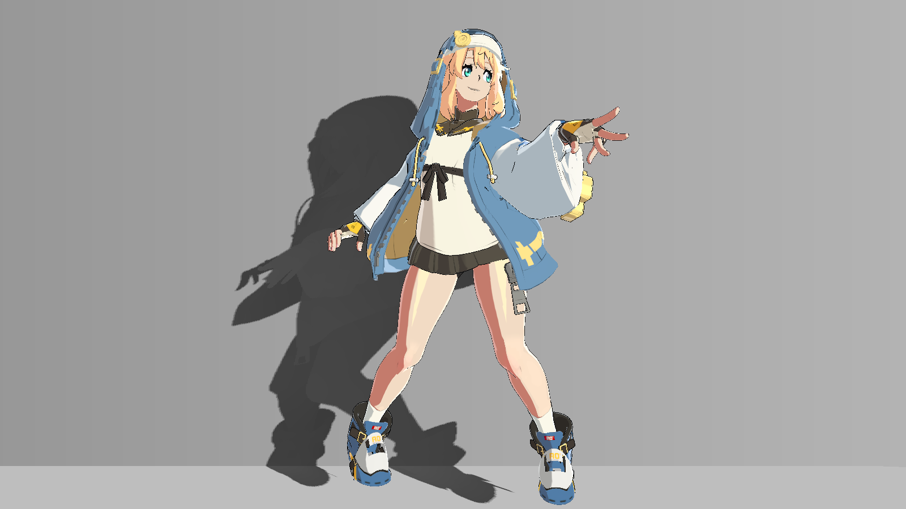
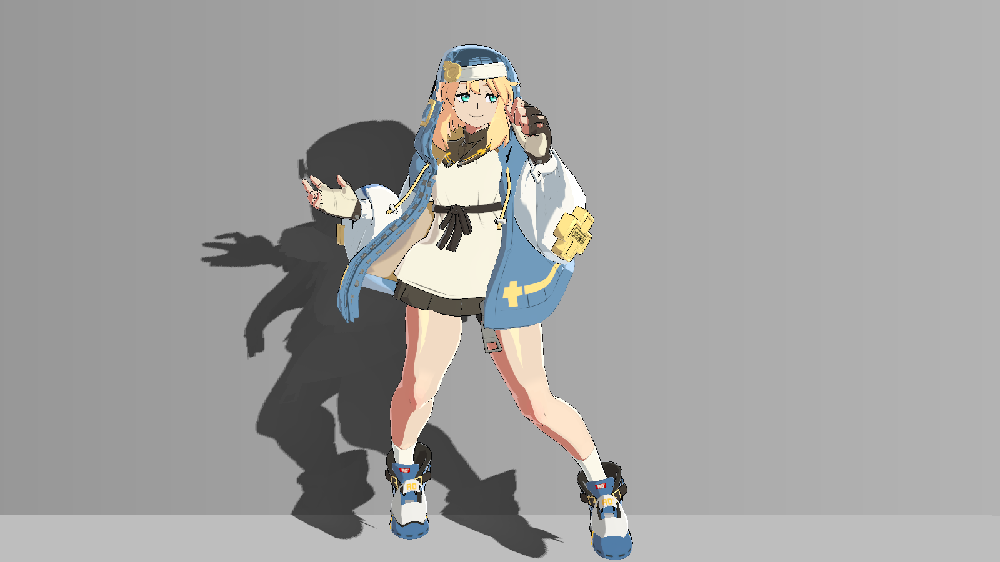

# 排查站立循环中的画面问题

完成静态画面后，播放已有站立循环，检查投影、眼睛、高光和描边是否在相同姿态下重复出现异常变化。不同姿态的正常运动与同姿态的闪变要分开判断。

| 对照 | 对照 |
|---|---|
| **站立cell00** [](../assets/images/standing/20261021/cf05441ff809410ab9d47fef6c3b6bc1e2817dfd99e4e5bb01c26d47ecd85937.png) | **站立cell07** [](../assets/images/standing/20261021/f83cf3684c8f54693fa3b21bf2f744085c51df1b077c8b6ae2c52132ce57f850.png) |

同镜头、同材质、不同姿态；1600×900、HDR关闭、RT单采样。观察投影和亮块随姿态的位置，不把两幅不同姿态当效果开关对照。

## 准备输入

固定相机、光照、分辨率、HDR/MSAA、贴图与材质设置。先确认现有动画能正常播放，不改动画、骨骼、网格或Bind Pose排除渲染问题。

对照图使用1600×900、HDR关闭、相机MSAA关闭、单采样RT。若你的目标配置不同，按自己的配置重新观察，不能直接用图像变化像素数比较质量。

## 操作步骤

1. 固定一个姿态，按1/4–9看输入，22/25/38看区域，16看漫反射，13看spec，12看rim，31看内部线，最后回0看外轮廓与完整颜色。
2. 播放完整站立循环并重复观察。重点看墙/地影子是否跟上角色、眼睛是否串区、大腿亮形是否越膝、外壳和内部细线是否突然断裂。
3. 遇到问题先暂停在同一姿态。只切一个相关开关，比较对应Debug分量，定位最后写入分支。
4. 如果仅第一次出现的姿态异常、下一帧恢复，先检查坐标/深度更新和原生蒙皮流的时序。读取画面应在正常主相机渲染结束后，不能在一次更新里反复手动Render后假定姿态已经刷新。
5. 再检查cell切换及回绕。Step动画本来就会离散换姿态，整幅图不同不等于Shader闪烁；要结合表面位置、阴影和分量一起判断。

## 原理与代码位置

同一姿态、相机、光和输入下，画面应可重复。不同姿态则会改变法线、遮挡、投影位置和像素覆盖，不应要求零差。

排查顺序是环境→输入→区域/覆盖→漫反射→高光/rim→线条→时序。切换Debug会隐藏外轮廓，检查线条时必须记得回0。对照图只帮助判断效果职责，不能代替自己设备上的HDR、抗锯齿和细线观察。

- [GGSTGeometryShadowMaps.cs:197–243](../reference/code/GGSTGeometryShadowMaps.cs.md#l197)：Ready / RenderMaps / DrawToonSubmeshes / Publish。
- [GGSTRegionalShading.cs:20–42](../reference/code/GGSTRegionalShading.cs.md#l20)：Apply / ResolveFrames / Set。
- [BridgetToon.shader:660–725](../reference/code/BridgetToon.shader.md#l660)：FORWARD：vert / frag及其计算函数。

局部摘录（需结合完整上下文）：[GGSTGeometryShadowMaps.cs:197–208](../reference/code/GGSTGeometryShadowMaps.cs.md#l197)。

```csharp
    // Build in onPreCull, execute after native cull/skinning and before opaque
    // shading. An immediate ExecuteCommandBuffer during pre-cull may see the
    // previous native skinned vertex buffer, so it is deliberately avoided.
    void RenderMaps(Camera camera)
    {
        if(!isActiveAndEnabled)return;
        ResolveReferences();
        if(camera!=mainCamera)return;
        if(commands!=null)commands.Clear();
        submitted=false;HairDrawCount=0;StageDrawCount=0;
        if(suspendMaps||!Ready())
        {DisableGlobals();if(suspendMaps)LastStatus="Suspended (offscreen draws only)";return;}
```

局部摘录（需结合完整上下文）：[BridgetToon.shader:687–693](../reference/code/BridgetToon.shader.md#l687)。

```hlsl
                if(mode==10)return half4(band.xxx,1);
                if(mode==11)return half4(rawShadow.xxx,1);
                if(mode==12)return half4(rim,1);
                if(mode==13)return half4(spec,1);
                if(mode==14)return half4(skin*half3(1,0.35,0.2)+hair*half3(0.2,0.4,1)+leather*half3(0.8,0.2,1)+metal*half3(0.2,1,0.8),1);
                if(mode==15)return half4(tex2D(_OutlineMap,i.uv.xy).rgb,1);
                if(mode==16)return half4(diffuse,1);
```

## 参数怎么调

下表区分Shader默认值与四主体材质设置。Base/Secondary/Flip/Coat对应四种主体材质；同名字段还可能被[MPB或全局输入](../reference/overrides.md)覆盖。完整属性类型和纹理绑定见[参数参考](../reference/parameters.md)。

| 属性 | 类型 | Shader默认 | 材质设置 | 作用 |
|---|---|---|---|---|
| _DebugMode | Range(0,24) | 0.0 | 0 | 选择需要隔离观察的分量，结束回0 |
| _CleanShadeEnabled | Range(0,1) | 0.0 | 1 | 排查最终区域漫反射 |
| _FocusedSpecEnabled | Range(0,1) | 0.0 | 1 | 排查分类高光的最后替换 |
| _ThighLobeEnabled | Range(0,1) | 0.0 | 1 | 隔离腿部局部高光 |
| _ReferenceRimEnabled | Range(0,1) | 0.0 | 1 | 区分rim与spec |

## 画面判断与排错

| 症状 | 先检查 | 如何区分 |
|---|---|---|
| 分区黑或头体混淆 | RegionalMask、head/enable MPB | 22看分区，38看覆盖 |
| 脸部参数没反应 | CleanShade重建 | 16看最终diffuse；35/36是替换前贡献 |
| 腿过亮或高光像塑料 | 分类、Focused、Thigh | 25→13→43/44 |
| 贴图边缘串色 | sRGB、压缩、MipMap、Wrap | 4–7对照实际导入设置 |
| 外轮廓刺出或缺失 | TANGENT、零宽、Debug | 回0，分开关外壳与内线 |
| 眼睛发白或串区 | 图集域、瞳孔保护、head | 33看区域，34看贡献，0看幅度 |
| 投影滞后或截断 | Ready、范围、VP、调度 | 对照draw、纹理与主相机渲染时机 |
| 整图灰或过曝 | 主光、环境、后处理 | 1→16→17区分输入与合成 |

逐姿态最终图、spec图和眼睛局部，以及更细的操作顺序见[站立画面排查](../reference/standing-stability-20261021.md)。不要为消除渲染异常而修改现有动画。

[上一步：整理内部线与外轮廓](11.md) · [教程导航](../index.md)
