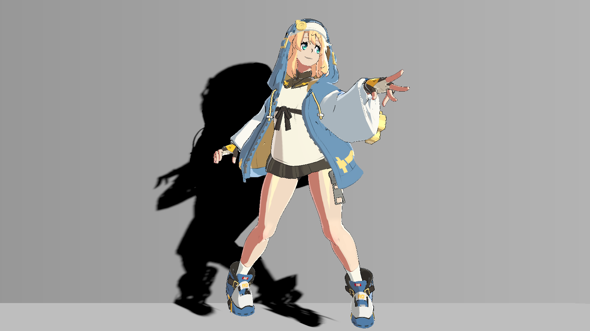
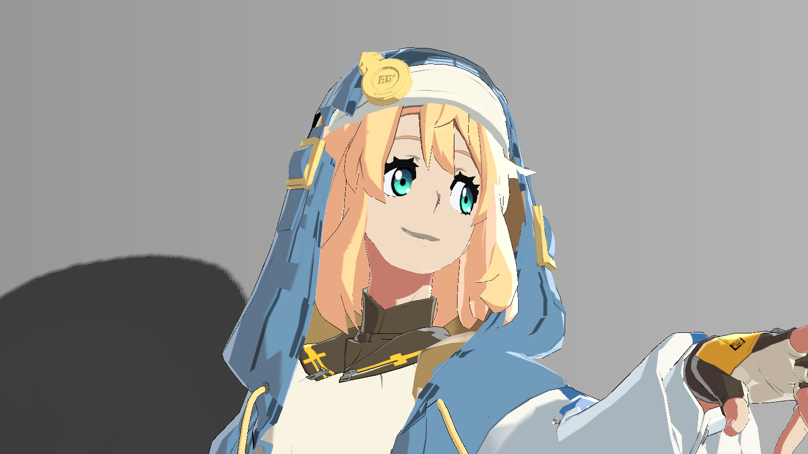

# 2026-10-21：投影 A/B 与眼睛开关实测

本页是**新增真实 Unity 渲染证据**，与原资料包分开登记。不是历史图重新命名，不是 AI 图或软件绘制的效果图。使用当前完整工程的隔离副本，在 Edit 模式截取已保存的站立 frame 0，没有进入 Play，没有调用 ShowFrame 或重建动画、骨骼、网格。原始资料包保持不变。

## 条件、来源与适用范围

| 条件 | 实际记录 |
|---|---|
| Unity | 2022.3.62f3c1 |
| 图形设备/API | NVIDIA GeForce RTX 3060 Laptop GPU / Direct3D11 |
| 管线/色彩 | Built-in / Linear |
| 每张原生图 | 1600×900，ARGB32临时RT，RGB24读回，单采样 |
| 相机 | HDR/MSAA关闭；Quality MSAA仍为4；固定16:9 |
| 姿态 | 保存的站立呈现；player/editPreview/bridge frame均为0 |
| 新旧图比较 | 与原工程历史图/4K副本的抗锯齿、构图条件不同，不跨批次作单变量A/B |
| 数量 | 23次Unity捕获；去重后12张不同原生PNG，另有2张精确裁切 |

进入副本前，完整 Assets/Packages/ProjectSettings 共428个文件与原采集快照一致。副本省略三个无关的请求文件自动化 Editor 工具及其.meta（6文件），保留422个原有输入；捕获结束后这些原输入哈希不变。九份渲染源码与资料包逐字节一致，保存场景哈希也一致。仅新增采集器，没有更改最终材质保存值。

每次相机连续 Render 三次后读回，以清除初次原生蒙皮流/深度图状态。对照记录了相机 view/projection、场景指纹、Renderer MPB、caster 标志、全局 enable、深度纹理哈希和非白像素数。重复帧用于检测本次静态采集漂移，不能证明站立循环或跨设备稳定性。

## 墙面投影：只改变接收器的一个属性

只改变 `GGST_Wall_ShadowReceiver` 的 Renderer MPB 属性 `_GeometryShadowFloor`：OFF为1，ON恢复保存材质0.1。**OFF仅指墙面自定义投影接收的可见衰减关闭**；地面、角色自身明暗不变。不是关闭全部阴影，没有改 caster、光、相机或材质文件。

| 墙面接收OFF：floor=1 | 墙面接收ON：保存值0.1 |
|---|---|
|  |  |

图注：本次隔离副本新 Unity 渲染、Debug0，同姿态、镜头与 RT；唯一变化是上述墙面属性。左图仍有地面投影，不能称为“无阴影”。ON与其他基线捕获同哈希，按清单复用 `floor_receiver_on.png`，不是拿不同条件的图配对。

| 指标 | 实测结果 |
|---|---|
| 变化像素（RGB任一通道非零） | 113785 |
| 最大8bit通道差 | 106 |
| 变化边界XYXY | [408,167,837,824] |
| ON重复帧差异 | 0像素 |

OFF/ON的 hair、stage 两张 RFloat 深度图字节哈希都相同，改变的是接收端，不是重新制作不同的投影几何。Stage/Hair全局enable有效，原始深度图存在非白深度像素。数值只描述本分辨率、本姿态的图像比较，不是性能或普遍质量评分。

## 地面投影：独立检查另一个接收面

只改变 `GGST_Floor_ShadowReceiver` 的同一 MPB 属性：OFF为1，ON为保存值0.08。墙面保持0.1，其他输入不变。

| 地面接收OFF：floor=1 | 地面接收ON：保存值0.08 |
|---|---|
|  |  |

图注：本次隔离副本真实 Unity Debug0 渲染，同镜头同姿态，只检验地面接收衰减；墙影和角色明暗保留。深度图哈希相同。变化9097像素，最大8bit通道差123，边界[469,824,910,891]；ON重复帧0像素差异。

源码依据为 [StageShadowReceiver.shader:44–59](code/StageShadowReceiver.shader.md#l44)：返回 `1-occlusion*(1-floor)`。floor=1时返回1；此时 `_StageShadowEnabled` 仍为1，**不会回退内置阴影**。实际颜色还乘接收面的原颜色和屏幕梯度，floor不是最终屏幕颜色。

## caster 开关：回退路径不是“全部投影关闭”

只切 `GGSTGeometryShadowMaps.drawStageCasters`。OFF时StageDrawCount=0、_StageShadowEnabled=0，接收器按 [80–86行](code/StageShadowReceiver.shader.md#l80)回到Unity的SHADOW_ATTENUATION。ON恢复自定义深度路径。所以这是**后备内置投影/自定义投影路径**比较。

| drawStageCasters=false：内置后备 | drawStageCasters=true：自定义路径 |
|---|---|
|  |  |

图注：本次同条件Unity Debug0图，只切caster标志；Stage深度图/enable及所选接收路径是该标志的后续变化。130546像素不同，最大通道差112；不是前两组的接收强度实验，不能与之混作同一A/B。这里没有修改内置ShadowCaster或角色的ReceiveShadowStrength。

## 眼睛：最终版本局部开关近景

只在站立头 Renderer MPB 写 `_EyeRefineEnabled=0/1`，其他材质保存值、CleanShade、Focused、Palette、Thigh、Rim及阴影保持不变。同组Debug编号一致。固定投影取景矩阵为m00=m11=3.5、m03=−(0.517×2−1)×3.5、m13=−(0.83×2−1)×3.5，再乘同一原始投影。没有移动相机Transform或改变姿态；完整矩阵见capture.json。

| 眼睛OFF：近景原图 | 眼睛ON：近景原图 |
|---|---|
|  |  |

图注：本次隔离副本新Unity渲染，1600×900、Debug0，同姿态同取景；唯一变量是头Renderer的眼睛开关。变化细微，不夸大为整个脸部重着色。

| OFF：同一矩形原像素局部 | ON：同一矩形原像素局部 |
|---|---|
|  |  |

裁切分别来自本组OFF/ON原图，矩形为 **[744,316,955,439]**，坐标原点为PNG左上，右下端不包含，输出 **211×123**。Pillow仅执行crop，没有缩放、锐化、修色或重绘；两张采用同一矩形。网页放大显示不改变图片像素，点击可看原尺寸。

| Debug33：虹膜/眼白/原白点域 | Debug34：代码中的眼睛贡献差值 |
|---|---|
|  |  |

图注：本次真实Unity诊断，不是最终着色。33为R虹膜/G眼白/B原白点；34为abs(eyeDiffuseDelta)+abs(color-eyeBeforeCatch)，不能将亮度当最终画面提亮量。两张用途不同，不是A/B效果图。

| 同条件OFF/ON比较 | 变化像素 | 最大8bit通道差 |
|---|---|---|
| Debug0最终颜色 | 3469 | 24 |
| Debug13最终高光 | 0 | 0 |
| Debug30内部线覆盖 | 0 | 0 |
| ON重复帧 | 0 | 0 |

Debug33眼区覆盖3866像素，最终颜色的3469个变化像素全部位于该域内，区域外变化 **0**；变化边界[760,332,939,423]。这是当前姿态的眼睛局部性证据，不能外推到其他UV、姿态、分辨率或HDR设置。

## 当前最终配置下，投脸 caster 的零差异

同一近景只切drawHairCasters，Debug0和Debug32的OFF/ON都为0像素变化；深度图不同，证明caster开关确实执行。主要站立头材质_HairFaceShadowStrength=0，CleanShade又会重建覆盖区漫反射。没有为“显示明显”调高旧参数或关闭CleanShade。

这不表示所有材质的投脸都关闭，也不表示投脸代码无效；其他材质、姿态与CleanShade组合仍待补。两张相同结果按哈希复用，23次捕获与12张原生PNG的对应关系保留在清单。

## 怎样复核

以下是独立新增记录，不改写原始资料包：

- [capture.json](../assets/evidence/rendering-ab-20261021/capture.json)：23次记录、矩阵、MPB与深度统计。
- [pixel-audit.json](../assets/evidence/rendering-ab-20261021/pixel-audit.json)：逐对像素结果。
- [images.json](../assets/evidence/rendering-ab-20261021/images.json)：捕获到去重图片的映射、SHA256及裁切坐标。
- [project-integrity.json](../assets/evidence/rendering-ab-20261021/project-integrity.json)、[428项输入哈希](../assets/evidence/rendering-ab-20261021/source-input-hashes.json)：只读源工程/副本与资料快照核对。
- [restoration.json](../assets/evidence/rendering-ab-20261021/restoration.json)：MPB、相机及caster恢复；隐式投影模式恢复且矩阵最大差为0。
- [实际编译执行的新增采集器源码](../assets/evidence/rendering-ab-20261021/capture-code.txt)：依赖完整工程原有类型，不是通用适配器或原资料快照。

在仓库运行 `python tools/verify_experiments.py`，会重算公开PNG的指标、局部性和裁切，并核对导出记录/源码哈希。它是证据复核，不会启动Unity。原工程428文件前后不变由采集时读盘比较记录；公开CI不能凭哈希创建缺失资源或代替Unity复测。

## 已补齐与仍待补

已补齐当前保存姿态下的墙/地单属性投影接收A/B、自定义/内置回退路径对照、最终眼睛开关近景及无修饰局部、重复帧与MPB/相机恢复证据。采集器及原渲染Shader已在上述隔离环境编译并渲染。

本静态批次不包含站立循环；后续[真实Play验收](standing-stability-20261021.md)已补本环境下的逐姿态/重复帧与正常观察，仍保留缺失实时tick及跨环境边界。仍待补：内置自阴影、投脸和CleanShade的其他组合；不同光向/设备/HDR/MSAA；TANGENT.xyz语义审计；换UV/模型与全新空项目通用适配。没有重做Play、性能或其他动作测试。参见[待补表](evidence.md)。
