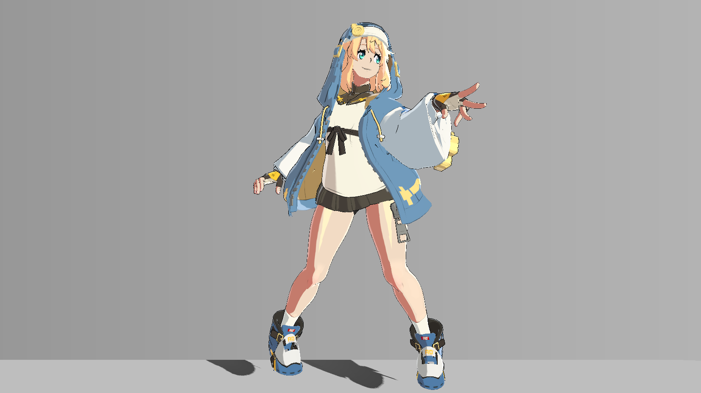
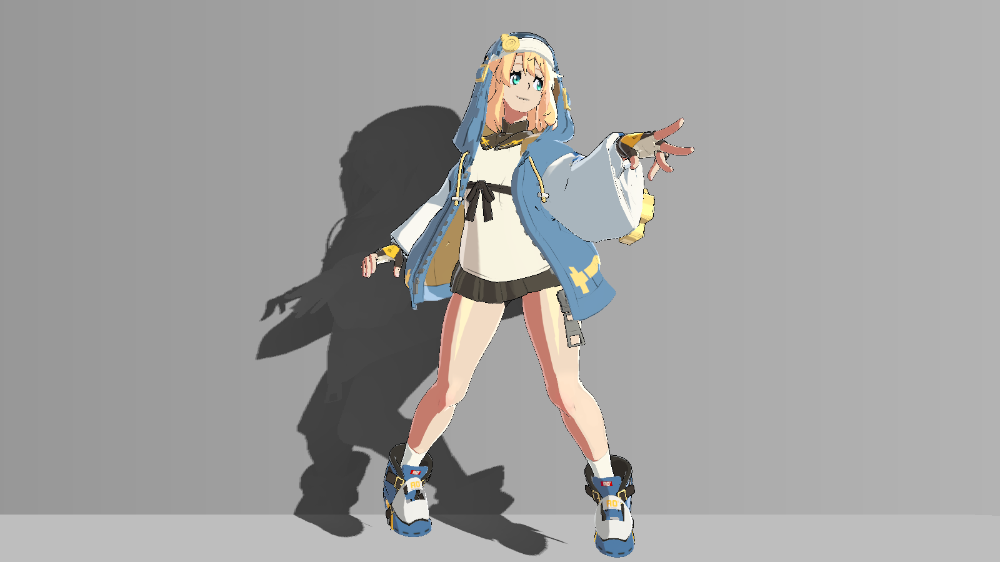
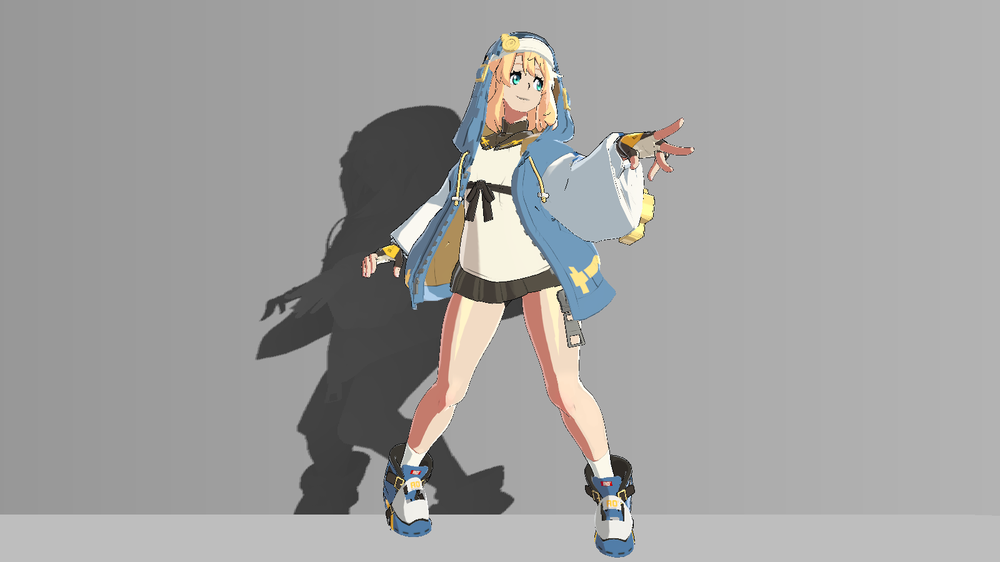
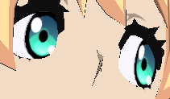
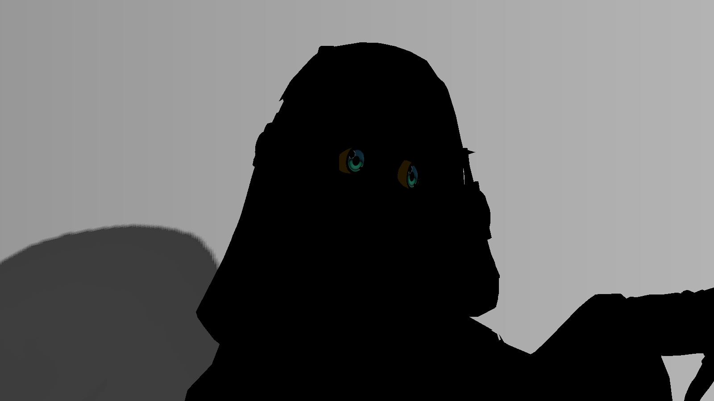

# 用同条件对照调投影与眼睛

先固定姿态、相机、主光和材质，只切一个负责目标效果的输入。下面的图使用Unity 2022.3.62f3c1、Built-in、Linear、1600×900，HDR关闭、相机MSAA关闭、RT单采样；不要直接与不同画质配置比较强弱。

## 只调墙面投影

1. 找到使用GGST/StageShadowReceiver的墙Renderer，保留原材质和其他MPB字段。
2. 将该Renderer MPB的_GeometryShadowFloor从0.1设为1；深度图和caster继续有效。
3. 墙面自定义接收衰减应消失，地面与角色着色保留。恢复0.1再判断影子形状。

| 墙面下限1 | 墙面下限0.1 |
|---|---|
| **只取消墙接收衰减**  | **恢复墙接收**  |

同姿态、同镜头、Debug0，只改墙接收器一个MPB字段。左图不是“无阴影”，仍有地面影子。

## 只调地面投影

对地面Renderer重复上述操作，将_GeometryShadowFloor在1和0.08之间切换，墙面保持0.1。

| 地面下限1 | 地面下限0.08 |
|---|---|
| **只取消地接收衰减**  | **恢复地接收**  |

同条件Debug0对照；墙影和角色明暗保留。可见率公式为`1-occlusion*(1-floor)`，所以floor=1不需要关闭深度图。源码见[StageShadowReceiver:44–59](code/StageShadowReceiver.shader.md#l44)。

如果切drawStageCasters，_StageShadowEnabled会变成0，接收器按[80–86行](code/StageShadowReceiver.shader.md#l80)回退Unity内置SHADOW_ATTENUATION。因此不能把这个开关当作“全部投影关闭”。

## 只调眼睛细化

1. 找到站立头Renderer，确认_RegionalHead=1。
2. 固定近景，只在该Renderer MPB切_EyeRefineEnabled=0/1；先GetPropertyBlock保留其他输入。
3. 比较Debug0的虹膜上暗下亮、边缘和原白点；瞳孔与整张脸不应一起提亮。
4. 使用33看R虹膜/G眼白/B原白点，再用34看代码中的眼睛贡献，最后回0判断真实幅度。

| 关闭细化 | 开启细化 |
|---|---|
| **OFF，Debug0**  | **ON，Debug0**  |

两张局部都来自相同1600×900近景，以[744,316,955,439]裁为211×123，没有缩放、修色或重绘；网页只负责显示大小，点击打开对应原图。

| 眼区诊断 | 眼睛贡献诊断 |
|---|---|
| **Debug33**  | **Debug34**  |

两张是不同用途的诊断，不是效果开关对照；34的亮度不是最终画面提亮量。若兜帽或脸颊出现在眼区里，先重定UV/颜色门控，再调强度。

## 开关没有变化时

投脸没有变化，先检查HairFaceShadowStrength、frameValid和CleanShade覆盖；不要为了看到明显暗带而改掉其他目标分支。眼睛没有变化，先区分“没有MPB覆盖”和“MPB明确写0”，并检查材质开关与head。

完成局部调参后，按[站立排查](standing-stability-20261021.md)检查姿态变化。光向、UV、HDR/MSAA和分辨率变化会影响采样及边缘，仍需在自己的目标配置下观察。
