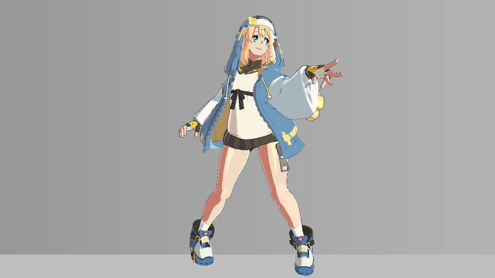
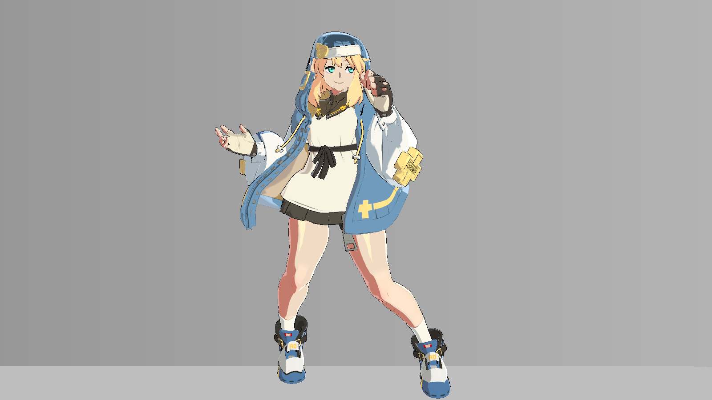
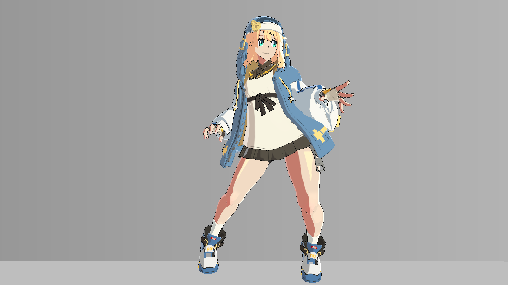
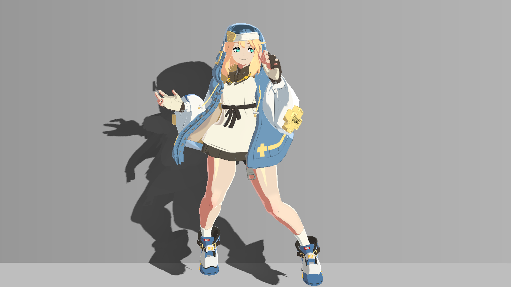
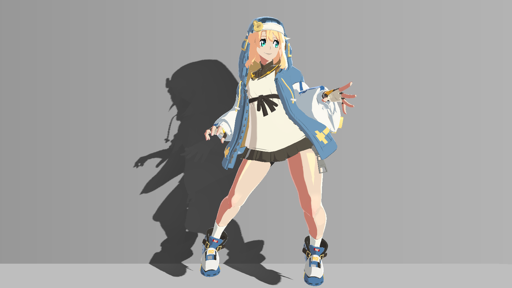
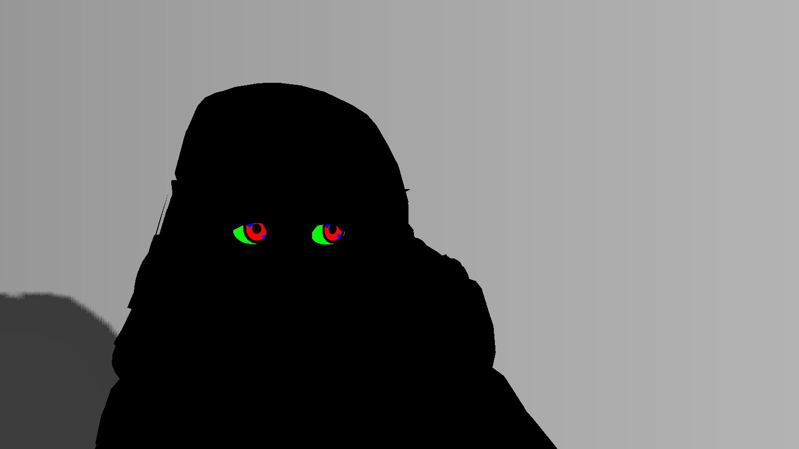
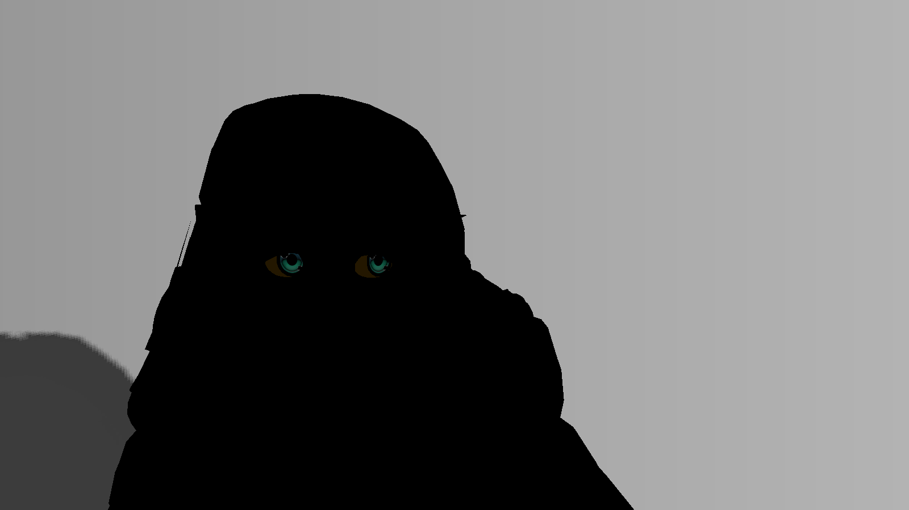

# 站立循环渲染稳定性：2026-10-21真实 Unity 验收

本次在完整工程的隔离副本中真实进入 **Play**，只运行现有站立循环。不改渲染源码、保存材质、动画、骨骼、网格、Bind Pose 或控制器。不是原资料包的历史验收，也不是此前23次静态A/B的扩展结论。

**结论限定于本次环境：同姿态重复、首次/下一帧、三个周期同tick，以及正常Play中相同cell的最终画面均无像素差异；未观察到额外的随机闪变。不同cell之间仍有明显的Step姿态变化，回绕也不是零差，不能宣称动画完全平滑。** 本页同时保留变化量、诊断原图和未覆盖条件。

## 采集条件与两个阶段

| 项目 | 实际条件 |
|---|---|
| 环境 | Unity 2022.3.62f3c1，Built-in，Linear，RTX 3060 Laptop GPU，Direct3D11 |
| 输出 | 1600×900，ARGB32临时RT、RGB24读回；相机HDR/MSAA关闭、RT单采样；Quality MSAA仍为4 |
| 场景 | 原保存场景 Bridget_ReferenceMatch，固定原主相机、主光及最终保存材质 |
| 站立时序 | 60 Hz，63 tick/周期（1.05秒），13个cell；现有播放器按Step保持原姿态，没有增加插值 |
| 受控阶段 | Play内暂停现有播放器自动推进，只调用其已有 SampleStandingLoopAt((tick+0.25)/60)；189个tick覆盖三周期 |
| 捕获时机 | 正常主相机onPostRender，姿态在此前LateUpdate准备；不调用Camera.Render |
| 受控图像记录 | 每tick首次和下一真实帧；第一周期13个cell起点再各捕获6个诊断/近景，总456条，来自456个不同Unity帧 |
| 正常Play阶段 | 恢复播放器，RestartAction("stand")后只观察现有LateUpdate及主相机，不手动采样；122条，跨8次回绕、覆盖13cell |
| 公开图片 | 578条记录按SHA256去重为91张原生PNG；另有13张精确眼区裁切，新增图片合计15.74 MB |

受控阶段每个tick至少保持两个真实Unity帧；切换诊断只写渲染MPB/投影矩阵，不更换资源。正常Play阶段取消这些诊断覆盖，继续使用相同RT。捕获读回和PNG编码会拖慢编辑器，**不能把122条/8.56秒当GPU性能基准或60fps验收**。

调试工具的早期本地试采发现：在单次编辑器更新或LateUpdate内反复手动Camera.Render，可能读到尚未更新的原生蒙皮流。那些试采没有收录。这里采用正常相机回调；受控与正常Play各cell最终PNG逐字节一致，且眼区位置确实随姿态变化，避免把冻结姿态误报为稳定。发布的源码哈希对应最终实际执行版本。

## 用什么判断“跳变”

先区分两类问题：**同姿态额外闪变**，与**不同姿态的正常画面变化**。前者可在固定输入下用零差复核；后者不能要求零差，也不能仅用一个像素数判断美术质量。

设两帧8bit RGB为I、J，本页变化像素数为 N=Σp [maxc |I(p,c)−J(p,c)|>0]；平均绝对通道差为 Σp,c |I−J|/(W×H×3)，单位仍是0–255。没有容差过滤，1级差也计入。它们不是运动补偿后的材质误差，也不是性能指标。

| 对比 | 实际比较次数 | 非零差次数 | 本次可支持的判断 |
|---|---:|---:|---|
| 每tick首次主相机帧/下一真实帧 | 189 | 0 | 本次没有首次呈现与下一帧不一致 |
| 三周期同tick | 126（63组） | 0 | 同一站立时相可重复 |
| 受控同cell保持 | 176（13组） | 0 | cell内没有额外闪变 |
| 正常Play同cell | 109（13组） | 0 | 实际观察到的重复姿态稳定 |
| 正常Play同tick | 64（58组） | 0 | 已观察的相同时相稳定 |
| 受控/正常Play同cell最终PNG | 13 | 0 | 两种采集得到相同最终画面；这不是额外效果开关A/B |

正常Play只覆盖58/63种tick，缺 **8、31、35、37、59**；受控采样补齐姿态/时相集合，但不能替代这些实时显示tick的观察。也没有覆盖进入Play的最早启动帧、跨设备、HDR或4×MSAA下的时序。

## 投影：跟随姿态，不随机消失

对每个cell，比较最终Debug0与两个场景接收器MPB的_GeometryShadowFloor同时设为1的诊断。后者仅去掉墙/地自定义接收衰减；caster和全局enable保持有效，不是“关闭所有阴影”，也不是上批各接收器独立单变量A/B。材质保存值墙0.1、地0.08保持原样。

13姿态中差异覆盖117650–133885像素；所有捕获的Stage/Hair全局enable=1、draw count>0，中心/投影矩阵随姿态记录。全局有效/有draw不等于每个深度像素都正确，本批未导出完整深度纹理，接触偏移、遮挡精度与自阴影的独立归因仍待补。

| 最终含投影 | 同姿态仅取消墙/地接收衰减 |
|---|---|
| **cell 00 full-settled**  | **cell 00 stage-receivers-off**  |
| **cell 07 full-settled**  | **cell 07 stage-receivers-off**  |
| **cell 12 full-settled**  | **cell 12 stage-receivers-off**  |

图注：全部为本次隔离副本真实Unity Debug0原图；每行固定姿态、镜头、资源，只诊断接收衰减。上下行改变了姿态，不是单变量效果实验。摄像机没有跟随角色；不要把投影随姿态的移动判成闪烁。

## 高光与描边：分开看，保留原有分支

Debug13仅返回Shader的spec变量，不代表眼睛白点、rim、漫反射亮面或全部最终亮部。保持CleanShade、Focused、FourMaterialSpec、ThighLobe、ReferenceRim的保存设置，没有调旧参数制造变化。逐姿态图可看大腿、衣料、头发/金属的亮块是否按当前姿态重排。

外轮廓使用同姿态最终图与所有主体Renderer MPB的_OutlineWidth=0对照，内部线条仍保留。13姿态差异5737–6577像素，没有发生整套外轮廓贡献归零；面积会随剪影、遮挡和皮肤宽度变化，不能把面积相近当作线宽均匀证明。TANGENT.xyz语义、细边亚像素闪动和其他分辨率仍待补。

| 原描边 | 只将外描边宽度设为0 |
|---|---|
| **cell 00 full-settled**  | **cell 00 outline-off**  |
| **cell 07 full-settled**  | **cell 07 outline-off**  |
| **cell 12 full-settled**  | **cell 12 outline-off**  |

图注：本次Debug0同姿态开关诊断；材质文件未保存修改。黑色细节不全部属于OUTLINE Pass，关闭外轮廓不会清除内部墨线。

## 13个姿态的最终画面与高光诊断

每行来自同一cell起点，同镜头、同资源；左Debug0、右Debug13，用途不同，不能把右图当最终显示颜色或“只开高光后的正确外观”。场景接收面没有使用角色Debug，因此背景投影仍会出现。点击打开1600×900原图。所有行是本次新增真实渲染，不混入历史图或演示副本。

| 最终画面 | spec诊断 |
|---|---|
| **cell 00 full-settled**  | **cell 00 specular**  |
| **cell 01 full-settled**  | **cell 01 specular**  |
| **cell 02 full-settled**  | **cell 02 specular**  |
| **cell 03 full-settled**  | **cell 03 specular**  |
| **cell 04 full-settled**  | **cell 04 specular**  |
| **cell 05 full-settled**  | **cell 05 specular**  |
| **cell 06 full-settled**  | **cell 06 specular**  |
| **cell 07 full-settled**  | **cell 07 specular**  |
| **cell 08 full-settled**  | **cell 08 specular**  |
| **cell 09 full-settled**  | **cell 09 specular**  |
| **cell 10 full-settled**  | **cell 10 specular**  |
| **cell 11 full-settled**  | **cell 11 specular**  |
| **cell 12 full-settled**  | **cell 12 specular**  |

## 眼睛：固定近景，固定裁切，不追着眼睛改窗口

近景始终使用同一3.5倍投影矩阵（沿用静态A/B的取景定义），没有逐姿态移动相机。13张近景原图分别按 **[451,207,969,506]** 裁切为 **518×299**；该窗口为13个Debug33眼区边界的并集加16像素边距，左上为原点，右下端不含。只crop，无缩放、修色、锐化或重绘；网页缩放只是显示排版。

_EyeRefineEnabled没有MPB覆盖（日志eyeOverride=false）；日志GetFloat所得0不是关闭眼睛，最终使用材质保存值1。Debug33覆盖2977–5190像素，随头姿态和投影而变；Debug34是源码中的眼睛贡献表达式，不是最终颜色的绝对提亮量。全部原图和0/33/34映射保留在清单中。

| 相邻姿态局部 | 相邻姿态局部 |
|---|---|
| **cell 00 · Debug0裁切**  | **cell 01 · Debug0裁切**  |
| **cell 02 · Debug0裁切**  | **cell 03 · Debug0裁切**  |
| **cell 04 · Debug0裁切**  | **cell 05 · Debug0裁切**  |
| **cell 06 · Debug0裁切**  | **cell 07 · Debug0裁切**  |
| **cell 08 · Debug0裁切**  | **cell 09 · Debug0裁切**  |
| **cell 10 · Debug0裁切**  | **cell 11 · Debug0裁切**  |
| **cell 12 · Debug0裁切**  | — |

图注：本次真实Unity近景的原像素裁切；相邻姿态的眼形/位置不同，不是局部开关A/B。点击链接指向对应完整近景，裁切坐标不随姿态改变。已有最终开关A/B仍见[静态实验](experiments-20261021.md)。

| Debug33区域（cell07） | Debug34贡献（cell07） |
|---|---|
| **cell 07 eye-regions**  | **cell 07 eye-contribution**  |

## 姿态切换与循环回绕：不是零差

相邻cell最终图变化146112–295102像素；cell12→00回绕变化290022像素，最大8bit通道差255、平均绝对通道差11.224964。回绕变化接近本组较大姿态转换，并没有满足“画面完全连续/平滑”的条件。公开原图供判断手、衣摆、腿、头和投影的共同位移；不能把运动造成的变化自动归因到某个Shader分支。

本次没有观察到同cell重复时投影、眼睛、高光或描边随机消失。姿态转换处的审美连续性、屏幕亚像素细线爬动与高光运动补偿分析仍待补；不改动画来抹去Step切换，也不以指标相近证明所有边界无问题。

| 回绕前cell12 | 回绕后cell00 |
|---|---|
| **cell 12 full-settled**  | **cell 00 full-settled**  |

图注：本次第一周期的cell12与cell00代表图；后续周期同tick完全一致，所以可用于显示该回绕两端。它们是不同姿态，绝不是单变量Shader A/B。

## 逐姿态数值与图片定位

“接收差异/外轮廓差异”来自同姿态各自的开关诊断；“前一cell变化”包含整幅运动；“眼区”来自Debug33彩色覆盖，均不能当材质物理面积。

| cell / 起始tick | 墙地接收差异像素 | 外轮廓差异像素 | Debug33眼区像素 | 前一cell→本cell最终变化 |
|---|---:|---:|---:|---:|
| 00 / 0 | 122882 | 6037 | 3866 | 290022 |
| 01 / 4 | 124232 | 5737 | 3538 | 283104 |
| 02 / 8 | 123849 | 6003 | 4352 | 219170 |
| 03 / 13 | 125708 | 6042 | 4477 | 146112 |
| 04 / 18 | 125531 | 6068 | 4067 | 208436 |
| 05 / 24 | 124997 | 6065 | 3762 | 231124 |
| 06 / 30 | 123898 | 6078 | 2977 | 188524 |
| 07 / 34 | 117650 | 6032 | 2979 | 187315 |
| 08 / 38 | 122767 | 6577 | 4412 | 262253 |
| 09 / 44 | 124193 | 6388 | 5021 | 295102 |
| 10 / 50 | 133100 | 6357 | 5190 | 289221 |
| 11 / 55 | 133339 | 6360 | 5076 | 218710 |
| 12 / 59 | 133885 | 6119 | 4981 | 157288 |

## 源码与参数依据

- [GGSTGeometryShadowMaps.cs:197–243](code/GGSTGeometryShadowMaps.cs.md#l197)：当前Renderer、头/骨盆坐标、光与投影更新；命令缓冲事件见[45行](code/GGSTGeometryShadowMaps.cs.md#l45)，位于BeforeForwardOpaque。
- [GGSTRegionalShading.cs:20–59](code/GGSTRegionalShading.cs.md#l20)：已有呈现帧到当前脸部MPB；没有重写动画。
- [BridgetImitateProfile.cs:31–44](code/BridgetImitateProfile.cs.md#l31)：当前角色原点/高度覆盖。本批每条记录包含这两个值及脸部帧向量。
- [StageShadowReceiver.shader:44–59](code/StageShadowReceiver.shader.md#l44)：接收下限1使可见自定义衰减消失，未切换caster或回退路径。
- [BridgetToon.shader:667–668](code/BridgetToon.shader.md#l667)、[690](code/BridgetToon.shader.md#l690)、[751–792](code/BridgetToon.shader.md#l751)：眼区/贡献、spec、外轮廓；Debug非0时外轮廓按776行裁掉。
- [实际执行的新增采集器](../assets/evidence/standing-render-20261021/capture-code.txt)：ControlledStep从156行开始，正常主相机回调NaturalFrame从211行开始。受控阶段禁用播放器自动推进并调用原采样API；正常阶段恢复播放器，只观察。此工具依赖未公开的完整工程组件，不是通用可复制适配器。

参数/输入版本与上批静态实验一致，详见[保存值与运行覆盖](overrides.md)。源码/材质/场景文件哈希一致只证明输入未变，不能代替各平台实际渲染。

## 下载与复核

以下均是独立新增记录，未写入原资料包。

- [controlled.json](../assets/evidence/standing-render-20261021/controlled.json)：456条受控帧与13姿态诊断。
- [natural.json](../assets/evidence/standing-render-20261021/natural.json)：122条正常Play帧及覆盖范围。
- [pixel-audit.json](../assets/evidence/standing-render-20261021/pixel-audit.json)：完整比较、边界与数值。
- [images.json](../assets/evidence/standing-render-20261021/images.json)：104张图片来源/用途/哈希清单。
- [image-map.json](../assets/evidence/standing-render-20261021/image-map.json)：91张原生PNG映射。
- [eye-crops.json](../assets/evidence/standing-render-20261021/eye-crops.json)：逐cell裁切到原图映射。
- [integrity.json](../assets/evidence/standing-render-20261021/integrity.json)：源工程428文件、副本422输入及执行源码核对。
- [source-input-hashes.json](../assets/evidence/standing-render-20261021/source-input-hashes.json)：428项原输入哈希（不含资源内容）。
- [采集器源码TXT](../assets/evidence/standing-render-20261021/capture-code.txt)：与实际执行C#字节一致。

安装仓库文档依赖后，运行 `python tools/verify_standing.py` 可重算PNG比较、裁切、覆盖和哈希；`python tools/verify_docs.py`会连同原包、摘录与所有实验一起核查。公开CI执行的是证据重算，**不会启动Unity，也不能凭哈希重建未公开模型或动画**。

如在自己的合法完整工程复测：先创建隔离副本，保留原文件哈希；确认现有站立播放正常；仅添加新增采集器；使用示例说明中的隔离marker和环境变量，从Unity批处理调用Run。工具会自行进入/退出Play并退出编辑器，不要添加自动退出参数抢先终止采集。没有完整依赖时不能宣称复制即可运行。

## 完成范围与保留项

完成本环境下的站立时相集合、相同姿态保持、三个周期可重复性、首次/下一真实帧、正常播放观察，以及投影/眼睛/spec/外轮廓诊断。原工程428项、隔离副本422项原输入前后不变，九份渲染源码与资料包一致，未保存场景或资源。原始资料包仍按原MANIFEST/Git基线核对。

仍待补：正常Play缺失的5种tick及最早启动帧；实际HDR/4×MSAA、其他分辨率/设备/光向；深度图精度与自阴影/投脸独立归因；眼睛遮挡/眨眼以外的新姿态和UV；高光运动补偿与细线亚像素观感；TANGENT.xyz语义；全新空工程适配。当前完整站立动作不会自动覆盖这些情况，不改原资源补齐它们。
